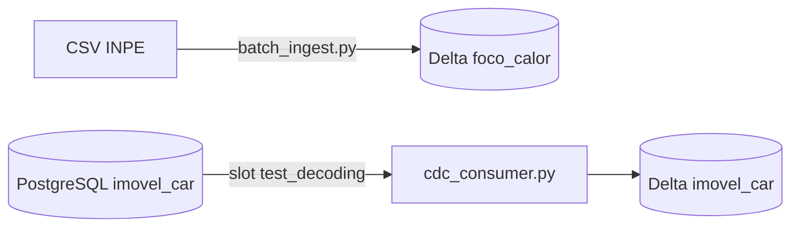

# Arquitetura da E2

## 1. Visão geral

| Caminho | Origem | Destino | Escopo |
| --- | --- | --- | --- |
| Lote | CSV do INPE (`data/processed`) | Delta `foco_calor`, partição `ano/mes` | `foco_calor` (insert-only) |
| CDC | WAL do PostgreSQL | Delta `imovel_car` | `imovel_car` (única tabela com INSERT, UPDATE e DELETE) |

`foco_calor` fica fora do CDC: o trigger `tg_foco_calor_imutavel` bloqueia UPDATE e DELETE, e o OLTP não tem a chave de deduplicação do lote (`id_foco` é identity e reinicia a cada recarga).

## 2. Decisões

### D1. Formato aberto: Delta Lake via `deltalake`

- Parquet com log Delta. Sem JVM e sem catálogo.
- Já implementado em `batch_ingest.py` (`MERGE`, partição, testes).
- Iceberg exigiria `pyiceberg`, catálogo e reescrita do lote e dos testes.

### D2. CDC: decodificação lógica nativa com `psycopg2`

- Plugin `test_decoding` (embutido no PostgreSQL). Sem publicação. O plugin não filtra tabelas: o consumidor descarta linhas que não são de `public.imovel_car`.
- Leitura por SQL, na conexão normal:
  - `pg_logical_slot_peek_changes(slot, NULL, N, 'skip-empty-xacts', '1')` devolve `lsn`, `xid` e `data`.
  - Após o commit no Delta: `pg_replication_slot_advance(slot, lsn_da_ultima_linha)`. O peek termina sempre em um `COMMIT`, então o avanço cai em fronteira de transação.
- Parâmetros do `db`: `wal_level=logical`, `max_replication_slots=4`, `max_slot_wal_keep_size=2GB`. Vão no `command` do Compose. Não há migration `V8`.

### D3. Estado inicial e slot

O consumidor, ao iniciar:

1. Cria o slot `cdc_imovel` se não existir e lê `confirmed_flush_lsn` em `pg_replication_slots`.
2. Se o slot foi criado agora ou a tabela Delta não existe: `SELECT` completo de `imovel_car`, gravado com `operacao_cdc='I'`, `origem_ingestao='snapshot'` e `lsn_origem` igual ao LSN do passo 1.
3. Entra no loop de consumo.

Mudanças ocorridas entre os passos 1 e 2 são reentregues pelo slot. A guarda de `lsn_origem` as torna idempotentes.

### D4. Tabela Delta `imovel_car`

Caminho: `data/delta/imovel_car`. Sem partição (dimensão pequena). Chave: `cod_imovel`.

| Coluna | Tipo | Observação |
| --- | --- | --- |
| `cod_imovel` | string | chave |
| `situacao`, `condicao` | string | |
| `area_ha` | double | |
| `data_download` | date | data da fonte |
| `geom_ewkb_hex` | string | hex repassado sem decodificar |
| `data_hora_ingestao` | timestamp | entrada na camada analítica |
| `origem_ingestao` | string | `snapshot` ou `cdc` |
| `operacao_cdc` | string | `I`, `U`, `D` |
| `lsn_origem` | long | LSN do evento |

Regras do `MERGE` por `cod_imovel`:

- `matched` e `source.lsn_origem >= target.lsn_origem`: atualiza. Menor que o armazenado: ignora (evento fora de ordem).
- `not matched`: insere.
- `DELETE`: o evento só traz a chave. Grava `operacao_cdc='D'` e preserva as demais colunas (exclusão lógica). O histórico do imóvel é a razão de versionar.
- `unchanged-toast-datum` no `geom`: a coluna é omitida do `UPDATE` e mantém o valor anterior.
- `TRUNCATE`: ignorado. As inserções seguintes (`load_camadas.py` recarrega com `ON CONFLICT DO NOTHING`) viram upserts.

### D5. Entrega: at-least-once com deduplicação no destino

- O LSN só é confirmado após o commit no Delta. Falha no meio: o slot reentrega, e `cod_imovel` mais a guarda de LSN impedem duplicata.
- Resultado observável: processamento efetivamente único no destino.
- Lote: `MERGE ... WHEN NOT MATCHED INSERT` por `id_foco`. Reexecução não altera a contagem.

### D6. Dado atrasado

Lote (`foco_calor`):

1. Partição `ano=YYYY/mes=MM` derivada de `data_hora_evento` em UTC (o CSV vem sem fuso, interpretado como UTC no contêiner).
2. `data_hora_ingestao` é coluna, nunca partição.
3. Registro atrasado cai na partição do evento sem tocar nas atuais (coberto por `test_tratamento_dados_atrasados_late_arriving`).
4. Reprocessar uma janela: reexecutar o arquivo do ano. O `MERGE` inclui o predicado de partição para limitar a leitura. Se o `deltalake` não podar por colunas do `source`, passar a lista literal de partições.
5. Limitação: o `MERGE` só insere. Correção de valores já gravados não é aplicada. Aceitável, pois focos do INPE são insert-only.

CDC (`imovel_car`): a ordem é garantida por `lsn_origem`, não por tempo de relógio.