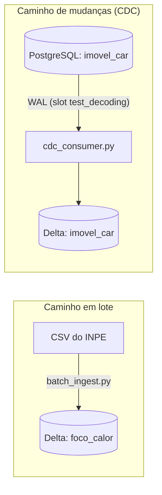

# Entrega 2: Ingestão em Lote e Captura de Mudanças

> Plataforma Corta-Fogo DF: ingestão em lote e captura de mudanças (CDC) do PostgreSQL com PostGIS para o armazenamento analítico em formato aberto (Parquet com tabela Delta Lake).

## 1. Visão Geral da Arquitetura

<em>Apresentação: Gabriel Souza</em>

Figura 1: Os dois caminhos de ingestão da Entrega 2

- **Lote:** carga idempotente e reexecutável dos focos de calor do INPE.
- **CDC:** mudanças de `imovel_car` lidas do WAL do PostgreSQL.
- **Destino:** Parquet com tabela Delta Lake, formato aberto.

## 2. Escopo: Lote e CDC

<em>Apresentação: Gabriel Souza</em>

| Aspecto | Lote | CDC |
| :--- | :--- | :--- |
| **Tabela** | `foco_calor` | `imovel_car` |
| **Origem** | CSV do INPE | WAL do PostgreSQL |
| **Destino** | Delta, partição `ano/mes` | Delta, sem partição |
| **Chave** | `id_foco` | `cod_imovel` |
| **Motivo** | Focos são insert-only: o trigger bloqueia UPDATE e DELETE. | Única tabela com INSERT, UPDATE e DELETE. |

`foco_calor` fica fora do CDC: no OLTP, o `id_foco` é identity e reinicia a cada recarga, então não há chave comum com o lote para deduplicar.

## 3. [Decisão Técnica de Arquitetura 0002](../../adr/02-mecanismo-de-ingestao-e-formato-aberto.md)

<em>Apresentação: João V. Farias (ADR)</em>

A decisão de arquitetura da Entrega 2 define como tiramos a carga analítica do PostgreSQL e organizamos o armazenamento em tabelas abertas:

- **Contexto:** na Entrega 1, a junção espacial completa demorou 41,8 segundos no PostgreSQL. Manter consultas desse porte disputando memória e CPU com a aplicação operacional não escala. Além disso, as duas fontes do projeto têm comportamentos opostos: os focos de calor são imutáveis e chegam em arquivos de satélite com possíveis atrasos temporais, enquanto os imóveis rurais sofrem alterações cadastrais contínuas (inclusões, retificações e cancelamentos).
- **Alternativas avaliadas:** comparamos três caminhos de ingestão (rodar SQL agendado no próprio banco, capturar mudanças do WAL via CDC ou fazer cargas periódicas em lote) e dois formatos de tabela aberta (Delta Lake e Apache Iceberg).
- **Medições práticas:** a opção de rodar SQL no banco parece rápida em testes isolados (~14 ms), mas concorre diretamente por recursos com o banco operacional. O CDC captura mutações do WAL com latência de ~32 ms de forma assíncrona, e a ingestão em lote grava em ~53 ms fora do banco. Nos testes de compressão, o algoritmo Zstandard (ZSTD) gerou arquivos 32,4% menores que o Snappy (64,2% de redução frente ao dado bruto em memória), sem perda perceptível de velocidade no DuckDB (~2,9 ms contra ~2,5 ms). Nos testes de falha, forçar o recuo do LSN no CDC não duplicou nenhum imóvel graças à guarda de versão.
- **Decisão:** adotamos uma solução híbrida com Delta Lake via biblioteca `deltalake` em Python, sem necessidade de JVM ou Spark. Os focos entram em lote particionados por `ano=YYYY/mes=MM/` com chave determinística `id_foco`. Os imóveis são sincronizados via CDC nativo do PostgreSQL (`test_decoding`) com `MERGE` controlado por LSN. Usamos compressão ZSTD nos arquivos Parquet e consultas analíticas no DuckDB.
- **Consequências:** isolamos o processamento analítico pesado fora do PostgreSQL usando uma pilha leve em Python. Reprocessar dados não gera duplicatas. Em contrapartida, precisamos monitorar o slot de replicação para evitar que o PostgreSQL acumule arquivos de WAL se o consumidor ficar inativo.
- **Gatilho de revisão:** se o INPE passar a emitir dados em fluxo contínuo de tempo real (subminuto via streaming) ou se o projeto exigir um catálogo compartilhado por vários motores analíticos em nuvem (como Trino e Spark), reavaliaremos o uso do Apache Iceberg com catálogo REST.

## 4. Formato Aberto: Delta Lake

<em>Apresentação: Manoel Felipe</em>

Optamos pelo Delta Lake como formato de tabela aberta para o lakehouse, gravando dados em Parquet com histórico de transações ACID na pasta `_delta_log/`.

Usamos a biblioteca `deltalake` (delta-rs), que roda em Python nativo compilado em Rust. Essa escolha foi prática: não precisamos subir uma JVM nem configurar clusters Spark nas máquinas locais. Avaliamos o Apache Iceberg, mas a biblioteca `pyiceberg` ainda depende de um serviço externo de catálogo (como Nessie ou REST Catalog) para coordenar escritas concorrentes, o que adicionaria contêineres e complexidade desnecessária ao Docker Compose.

### Estrutura da Tabela Delta `imovel_car`

A tabela de imóveis rurais usa `cod_imovel` como chave primária e não tem particionamento. Como são cerca de 21 mil registros, dividir essa dimensão em pastas criaria arquivos minúsculos, prejudicando o desempenho de leitura no DuckDB.

| Grupo | Colunas | Função prática |
| :--- | :--- | :--- |
| Dados cadastrais | `cod_imovel`, `situacao`, `condicao`, `area_ha`, `data_download` | Atributos originais da base do SICAR. |
| Geometria vetorial | `geom_ewkb_hex` | Polígono serializado em hexadecimal EWKB, repassado sem reprocessamento para poupar CPU. |
| Controle de versão | `data_hora_ingestao`, `origem_ingestao`, `operacao_cdc`, `lsn_origem` | Metadados para identificar se a linha veio do snapshot inicial ou do CDC, o tipo de mutação (`I`, `U`, `D`) e o offset no WAL. |

Quando um imóvel é cancelado no PostgreSQL, o consumidor não remove o registro fisicamente da tabela Delta. Ele grava uma exclusão lógica (`operacao_cdc = 'D'`), preservando o histórico para auditoria espacial.

## 5. CDC: Como Funciona

<em>Apresentação: Gabriel Fernando</em>

Em vez de subir contêineres pesados como Kafka, Zookeeper e Debezium, implementamos a captura de mudanças usando a decodificação lógica nativa do próprio PostgreSQL com o plugin `test_decoding` e a biblioteca `psycopg2`.

O fluxo de sincronização opera em cinco etapas:

1. **Geração do log:** qualquer `INSERT`, `UPDATE` ou `DELETE` na tabela `imovel_car` é gravado no WAL pelo PostgreSQL (`wal_level=logical`).
2. **Retenção no slot:** o slot de replicação `cdc_imovel` retém os eventos de transação até que o consumidor confirme sua leitura.
3. **Leitura filtrada:** o script [`cdc_consumer.py`](https://github.com/BeyondMagic/corta-fogo-df/blob/main/src/pipeline/cdc_consumer.py) consulta as alterações pendentes via SQL (`pg_logical_slot_peek_changes`) e filtra apenas as mutações relativas a `public.imovel_car`.
4. **Aplicação no lakehouse:** o consumidor monta o lote de alterações e executa um `MERGE` atômico na tabela Delta de imóveis, indexado por `cod_imovel`.
5. **Confirmação do LSN:** o ponteiro de replicação só avança (`pg_replication_slot_advance`) após a confirmação do commit no Delta Lake. Se a escrita falhar, o slot não avança e o evento é reprocessado na próxima tentativa.

Se a tabela Delta ainda não existir ou o slot for recém-criado, o consumidor executa primeiro uma carga inicial completa (*snapshot* de todos os 21.047 imóveis) antes de iniciar a escuta contínua de mudanças.

## 6. Semântica de Entrega

<em>Apresentação: Elias F.</em>

Adotamos a estratégia de **entrega at-least-once com deduplicação no destino**. Em sistemas de dados, tentar garantir exatamente-uma-vez no transporte costuma exigir protocolos frágeis de duas fases. É mais seguro permitir que mensagens sejam reenviadas e garantir que o destino saiba descartar duplicatas.

| Fluxo | Chave de controle | Comportamento ao reprocessar |
| :--- | :--- | :--- |
| **Lote (Focos)** | Hash determinístico `id_foco` | Cláusula `WHEN NOT MATCHED INSERT`. Se o lote for executado três vezes seguidas, as linhas existentes são ignoradas e a contagem final não muda. |
| **CDC (Imóveis)** | Chave `cod_imovel` e guarda `lsn_origem` | O slot pode reentregar eventos após uma queda do consumidor. A condição `source.lsn_origem >= target.lsn_origem` impede que mutações antigas sobrescrevam o estado atual. |

O avanço do LSN no PostgreSQL só acontece depois que o commit no Delta Lake termina com sucesso. Se o script cair no meio da gravação, o PostgreSQL reentrega os mesmos eventos assim que o consumidor reiniciar.

Comprovamos isso no teste automatizado [`test_reprocessamento_cdc.py`](https://github.com/BeyondMagic/corta-fogo-df/blob/main/scripts/testes/test_reprocessamento_cdc.py): forçamos o recuo do cursor de leitura para um LSN passado e reenviamos dados desordenados. A tabela Delta descartou todos os registros obsoletos e manteve zero duplicações.

## 7. Tratamento de Dados Atrasados

<em>Apresentação: João V. Farias</em>

Tanto no monitoramento de queimadas quanto no cadastro de terras, eventos reais chegam frequentemente fora de ordem cronológica (*late-arriving data*). O INPE pode reprocessar órbitas antigas e publicar detecções de 2024 em um arquivo recente, assim como retificações de imóveis podem tramitar por meses antes de serem registradas.

Resolvemos esse desafio com duas regras estruturais:

| Fluxo | Regra para dados atrasados | Por que funciona |
| :--- | :--- | :--- |
| **Lote (Focos)** | Particionamento físico `ano=YYYY/mes=MM/` baseado exclusivamente em `data_hora_evento` (UTC). | O registro atrasado é gravado diretamente na pasta do ano e mês em que o fogo ocorreu. As partições vigentes não sofrem reescrita. O campo `data_hora_ingestao` é guardado apenas como coluna de auditoria, nunca como partição. |
| **CDC (Imóveis)** | Ordenação estrita pelo `lsn_origem` do WAL do PostgreSQL. | Relógios de servidores sofrem desvios (*clock drift*). Ordenar pelo LSN de 64 bits garante a sequência lógica real das transações, ignorando qualquer evento que chegue com número de sequência inferior ao já gravado. |

Essa separação garante que reprocessar um ano inteiro seja apenas rodar o arquivo daquele ano: o `MERGE` insere os focos que faltavam e preserva os que já estavam gravados.

## 8. Artefatos e Entregáveis da Entrega 2

<em>Apresentação: Samuel Ribeiro</em>

Todos os códigos, testes e relatórios da Entrega 2 estão implementados e versionados no repositório:

- **[Decisão de Arquitetura 0002](../../adr/02-mecanismo-de-ingestao-e-formato-aberto.md):** documento formal detalhando o contexto, alternativas avaliadas, critérios técnicos e medições comparativas.
- **[Pipeline em Lote (`batch_ingest.py`)](https://github.com/BeyondMagic/corta-fogo-df/blob/main/src/pipeline/batch_ingest.py):** script responsável pela carga idempotente dos focos de satélite em arquivos Parquet com Delta Lake, particionado por ano e mês.
- **[Consumidor CDC (`cdc_consumer.py`)](https://github.com/BeyondMagic/corta-fogo-df/blob/main/src/pipeline/cdc_consumer.py):** script que lê eventos de transação do slot lógico `cdc_imovel` no PostgreSQL e atualiza a tabela Delta de imóveis rurais.
- **[Simulador de Mutações no OLTP (`mutacoes_imovel.py`)](https://github.com/BeyondMagic/corta-fogo-df/blob/main/scripts/cdc/mutacoes_imovel.py):** rotina que insere, altera e remove imóveis no banco operacional para demonstrar a captura contínua de mudanças.
- **[Testes Automatizados de Idempotência e Reprocessamento](https://github.com/BeyondMagic/corta-fogo-df/tree/main/scripts/testes):** suíte contendo [`test_idempotencia_lote.py`](https://github.com/BeyondMagic/corta-fogo-df/blob/main/scripts/testes/test_idempotencia_lote.py) (lote e dados atrasados) e [`test_reprocessamento_cdc.py`](https://github.com/BeyondMagic/corta-fogo-df/blob/main/scripts/testes/test_reprocessamento_cdc.py) (reentrega forçada de LSN).
- **[Benchmarks de Latência e Compressão](https://github.com/BeyondMagic/corta-fogo-df/tree/main/scripts/benchmark):** scripts e relatórios que medem o tempo de propagação do CDC vs lote e a taxa de redução do algoritmo ZSTD.
- **[Ambiente Conteinerizado (`docker-compose.yml`)](https://github.com/BeyondMagic/corta-fogo-df/blob/main/docker-compose.yml):** configuração do PostgreSQL com PostGIS e parâmetros de replicação lógica ativados (`wal_level=logical`).

## 9. Diário de Bordo: Semanas 7 e 8

<em>Apresentação: Cláudio Henrique</em>

O ciclo inicial da Entrega 2 foi dedicado a consolidar os ajustes da primeira etapa e planejar as frentes de trabalho:

- **Semana 7:** revisamos a documentação da Entrega 1 com base no retorno da professora em sala, consolidando o histórico das camadas territoriais e refinando os índices GiST no PostGIS.
- **Semana 8 (30/09):** realizamos a reunião de planejamento da E2. Definimos que os focos seriam tratados em lote pela natureza imutável dos dados e que o CDC seria aplicado exclusivamente sobre `imovel_car`, evitando complexidade desnecessária.

## 10. Diário de Bordo: Semana 9

Na nona semana, estruturamos a base do lakehouse e o pipeline dos focos de calor:

- **05/10:** consolidamos o documento de arquitetura da E2 e implementamos o script [`batch_ingest.py`](https://github.com/BeyondMagic/corta-fogo-df/blob/main/src/pipeline/batch_ingest.py), gravando focos do INPE em Delta Lake particionados por ano e mês.
- **06/10:** criamos os testes automatizados de idempotência e dados atrasados em [`test_idempotencia_lote.py`](https://github.com/BeyondMagic/corta-fogo-df/blob/main/scripts/testes/test_idempotencia_lote.py).
- **09/10:** configuramos o contêiner do PostgreSQL no `docker-compose.yml` para habilitar replicação lógica (`wal_level=logical`, 4 slots de replicação e limite de 2 GB de retenção de WAL).
- **Decisões técnicas da semana:** descartamos o Apache Iceberg por exigir JVM e catálogo externo; adotamos o Delta Lake via `deltalake` (delta-rs); e optamos por usar a decodificação lógica nativa (`test_decoding`) com `psycopg2`, dispensando o Debezium e o Kafka.

## 11. Diário de Bordo: Semana 10

A décima semana focou na captura contínua de mudanças cadastrais e na validação de resiliência:

- **10/10:** finalizamos o consumidor CDC [`cdc_consumer.py`](https://github.com/BeyondMagic/corta-fogo-df/blob/main/src/pipeline/cdc_consumer.py), que carrega o snapshot inicial de imóveis e passa a consumir o slot de replicação continuamente.
- **10/10:** criamos o script [`mutacoes_imovel.py`](https://github.com/BeyondMagic/corta-fogo-df/blob/main/scripts/cdc/mutacoes_imovel.py) para simular inserções, atualizações de área e exclusões no PostgreSQL, provando a captura de mudanças em tempo real.
- **11/10:** implementamos os testes de resiliência em [`test_reprocessamento_cdc.py`](https://github.com/BeyondMagic/corta-fogo-df/blob/main/scripts/testes/test_reprocessamento_cdc.py), forçando recuo de LSN para validar que a reentrega de eventos não gera duplicatas.
- **Decisões técnicas da semana:** exclusões no banco são salvas como soft-delete (`operacao_cdc='D'`) na tabela Delta; e a confirmação do LSN no PostgreSQL só ocorre após o commit no disco, assegurando entrega at-least-once com deduplicação no destino.
