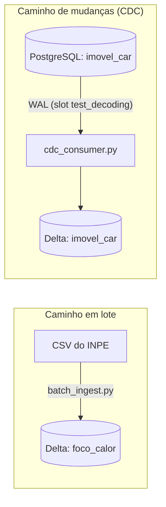

# Entrega 2: Ingestão em Lote e Captura de Mudanças

> Plataforma Corta-Fogo DF: ingestão em lote e captura de mudanças (CDC) do PostgreSQL com PostGIS para o armazenamento analítico em formato aberto (Parquet com tabela Delta Lake).

## 1. Visão Geral da Arquitetura

<em>Apresentação: Gabriel Souza</em>

Figura 1: Os dois caminhos de ingestão da Entrega 2

- **Lote:** carga idempotente e reexecutável dos focos de calor do INPE.
- **CDC:** mudanças de `imovel_car` lidas do WAL do PostgreSQL.
- **Destino:** Parquet com tabela Delta Lake, formato aberto.

## 2. Escopo: Lote e CDC

<em>Apresentação: Gabriel Souza</em>

| Aspecto | Lote | CDC |
| :--- | :--- | :--- |
| **Tabela** | `foco_calor` | `imovel_car` |
| **Origem** | CSV do INPE | WAL do PostgreSQL |
| **Destino** | Delta, partição `ano/mes` | Delta, sem partição |
| **Chave** | `id_foco` | `cod_imovel` |
| **Motivo** | Focos são insert-only: o trigger bloqueia UPDATE e DELETE. | Única tabela com INSERT, UPDATE e DELETE. |

`foco_calor` fica fora do CDC: no OLTP, o `id_foco` é identity e reinicia a cada recarga, então não há chave comum com o lote para deduplicar.

## 3. Formato Aberto: Delta Lake

<em>Apresentação: Manoel Felipe</em>

- **Decisão:** Parquet com log Delta, pela biblioteca `deltalake` (Python).
- **Motivo:** sem JVM e sem catálogo. Já em uso no lote (`MERGE`, partição, testes).
- **Descartado:** Iceberg exigiria `pyiceberg`, catálogo e reescrita do lote e dos testes.

### Tabela Delta `imovel_car`

Chave `cod_imovel`, sem partição (dimensão pequena). Exclusão lógica (`operacao_cdc='D'`).

| Grupo | Colunas |
| :--- | :--- |
| Dados do imóvel | `cod_imovel`, `situacao`, `condicao`, `area_ha`, `data_download`, `geom_ewkb_hex` (hex repassado sem decodificar) |
| Controle do CDC | `data_hora_ingestao`, `origem_ingestao` (`snapshot` ou `cdc`), `operacao_cdc` (`I`, `U`, `D`), `lsn_origem` |

## 4. CDC: Como Funciona

<em>Apresentação: Gabriel Fernando</em>

1. O PostgreSQL grava as mudanças no WAL (`wal_level=logical`).
2. O slot `cdc_imovel`, com o plugin `test_decoding`, retém os eventos.
3. O `cdc_consumer.py` lê o slot por SQL (`pg_logical_slot_peek_changes`) e mantém só as linhas de `public.imovel_car`.
4. O consumidor aplica um `MERGE` no Delta por `cod_imovel`.
5. Só depois do commit no Delta o LSN é confirmado (`pg_replication_slot_advance`).

- **Estado inicial:** se o slot é novo ou a tabela Delta não existe, o consumidor grava antes um snapshot completo de `imovel_car`.
- **Sem serviço novo:** decodificação lógica nativa do PostgreSQL, `psycopg2` e `deltalake`. Sem Debezium e sem broker.

## 5. Semântica de Entrega

<em>Apresentação: Elias F.</em>

**At-least-once com deduplicação no destino.**

| Caminho | Chave de deduplicação | Ao reprocessar |
| :--- | :--- | :--- |
| Lote | `id_foco` | `MERGE ... WHEN NOT MATCHED INSERT`: a contagem não muda. |
| CDC | `cod_imovel` e `lsn_origem` | O slot reentrega os eventos e a guarda de LSN impede duplicata. |

- O LSN só é confirmado depois do commit no Delta. Se o consumidor falhar antes, o slot reentrega e nenhuma mudança se perde.
- Efeito observável: o Delta fica igual com ou sem reprocessamento.

## 6. Dado Atrasado

<em>Apresentação: João V. Farias</em>

| Caminho | Regra |
| :--- | :--- |
| Lote | Partição `ano=YYYY/mes=MM` por `data_hora_evento` (UTC). O registro atrasado cai na partição do evento e não toca nas atuais. |
| Lote: reprocessar janela | Reexecutar o arquivo do ano. O `MERGE` só insere, o que basta porque os focos do INPE são insert-only. |
| CDC | Ordem por `lsn_origem`, não por relógio. Evento com LSN menor que o armazenado é ignorado. |

`data_hora_ingestao` é coluna, nunca partição.

## 7. Artefatos e Entregáveis

<em>Apresentação: Samuel Ribeiro</em>

- **[Arquitetura detalhada](https://github.com/BeyondMagic/corta-fogo-df/blob/main/e2/arquitetura.md):** decisões D1 a D6 e regras do `MERGE`.
- **[Ingestão em lote](https://github.com/BeyondMagic/corta-fogo-df/blob/main/src/pipeline/batch_ingest.py):** carga idempotente dos focos de calor em Delta Lake.
- **[Consumidor CDC](https://github.com/BeyondMagic/corta-fogo-df/blob/main/src/pipeline/cdc_consumer.py):** sincroniza `imovel_car` com a tabela Delta.
- **[Esquema da tabela aberta](https://github.com/BeyondMagic/corta-fogo-df/blob/main/docs/modelagem/esquema_tabela_aberta.md):** colunas, tipos e contrato da tabela Delta.
- **[Testes](https://github.com/BeyondMagic/corta-fogo-df/tree/main/scripts/testes):** idempotência e dado atrasado do lote (`test_idempotencia_lote.py`) e do consumidor CDC (`test_cdc_consumer.py`).
- **[Mutações no OLTP](https://github.com/BeyondMagic/corta-fogo-df/tree/main/scripts/cdc):** script que altera `imovel_car` para provar a captura de mudanças.
- **[Docker Compose](https://github.com/BeyondMagic/corta-fogo-df/blob/main/docker-compose.yml):** PostgreSQL com decodificação lógica habilitada.
- **[Diário de bordo completo](https://github.com/BeyondMagic/corta-fogo-df/blob/main/e2/diario-de-bordo.md):** texto integral das semanas 7 a 10.

## 8. Diário de Bordo: Semanas 7 e 8

<em>Apresentação: Cláudio Henrique</em>

| Semana | Registro |
| :--- | :--- |
| 7 | Correção da Entrega 1 (E1) conforme as observações da professora. Sem entrega da E2. |
| 8 | **30/09:** reunião do grupo para organização da E2. Sem entrega. As entregas da E2 começaram na semana 9. |

## Diário de Bordo: Semana 9

| Data | O que foi feito |
| :--- | :--- |
| 05/10 | Documento de arquitetura da E2 consolidado. |
| 05/10 | Ingestão em lote dos focos do INPE em Delta Lake (`batch_ingest.py`), com `MERGE` por `id_foco`. |
| 06/10 | Testes de idempotência, partição e dado atrasado do lote (`test_idempotencia_lote.py`). |
| 09/10 | PostgreSQL configurado para decodificação lógica (`wal_level=logical`, `max_replication_slots=4`, `max_slot_wal_keep_size=2GB`). |

**Decisões**

- **Formato aberto: Delta Lake via `deltalake`.** Sem JVM e sem catálogo. Iceberg exigiria `pyiceberg`, catálogo e reescrita do lote.
- **Dado atrasado no lote.** Partição `ano/mes` por `data_hora_evento` (UTC). Reprocessar uma janela é reexecutar o arquivo do ano.
- **Escopo do CDC: só `imovel_car`.** Única tabela com INSERT, UPDATE e DELETE. `foco_calor` é imutável e fica no lote.
- **CDC com `test_decoding` e `psycopg2`.** Decodificação lógica nativa do PostgreSQL, sem serviço novo no Compose.

## Diário de Bordo: Semana 10

| Data | O que foi feito |
| :--- | :--- |
| 10/10 | Consumidor CDC (`cdc_consumer.py`) que grava `imovel_car` em uma tabela Delta. |
| 10/10 | Script de mutações no OLTP para provar que o CDC captura mudanças. |
| 11/10 | Testes do consumidor CDC (reprocessamento e idempotência). |

**Decisões**

- **Estado inicial e slot.** O consumidor cria o slot `cdc_imovel` e carrega um snapshot completo de `imovel_car`. Mudanças entre os dois passos são reentregues e absorvidas pela guarda de `lsn_origem`.
- **Tabela Delta `imovel_car`.** Chave `cod_imovel`, sem partição, `geom_ewkb_hex` repassado sem decodificar. Exclusão lógica (`operacao_cdc='D'`).
- **Dado atrasado no CDC.** Ordem por `lsn_origem`. Evento com LSN menor que o armazenado é ignorado, sem depender do relógio.
- **Semântica de entrega: at-least-once com deduplicação no destino.** O LSN só é confirmado depois do commit no Delta. A reentrega não duplica.
