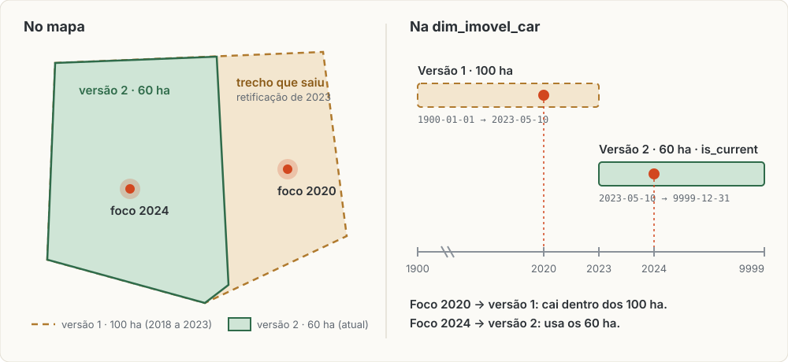

# :material-numeric-3-box: Entrega 3: Modelagem Dimensional, Transformação e Orquestração

> Plataforma Corta-Fogo DF: modelo dimensional em estrela na camada Gold, histórico cadastral com SCD Tipo 2, transformações declarativas no dbt-duckdb, testes de dados e orquestração com Dagster.

## 1. Visão Geral e Pergunta de Gestão

<p class="apresentador"><em>Apresentação: Gabriel Souza</em></p>

> **Quais imóveis rurais do Distrito Federal tiveram focos de calor reincidentes em áreas de reserva legal, de preservação permanente ou a até 1 km de unidades de conservação entre 2015 e 2025?**

Um imóvel é reincidente quando tem foco em uma dessas áreas em pelo menos 2 anos civis (UTC) distintos. Todos os satélites entram na contagem. A decisão apoiada é a ordem das vistorias: a camada Gold entrega os reincidentes como uma fila, ordenada pelo Índice de Prioridade de Vistoria ([ADR 0005](../../adr/05-indice-de-prioridade-de-vistoria.md)).

--8<-- "docs/snippets/arquitetura_camadas.md"

<p style="text-align: center; font-size: 0.9em; color: #64748b;">Figura 1: Linhagem interativa dos modelos dbt, das fontes Bronze/Silver à camada Gold e consumo</p>

## 2. Divisão de Responsabilidades da Equipe

<p class="apresentador"><em>Apresentação: Gabriel Souza</em></p>

| Integrante | Frente | Issue | Entrega |
| :--- | :--- | :---: | :--- |
| Gabriel Souza | Coordenação e Pergunta de Gestão | [#17](https://github.com/BeyondMagic/corta-fogo-df/issues/17) | Este relatório, consulta final e auditoria do checklist |
| Manoel Felipe | Modelagem Dimensional Gold | [#18](https://github.com/BeyondMagic/corta-fogo-df/issues/18) | Esquema estrela, `fato_foco_calor` e `mart_reincidencia_imovel_ano` |
| Samuel Ribeiro | Dimensão de Variação Lenta | [#19](https://github.com/BeyondMagic/corta-fogo-df/issues/19) | Snapshot e `dim_imovel_car` (SCD Tipo 2) |
| Gabriel Fernando | Camadas de Transformação | [#20](https://github.com/BeyondMagic/corta-fogo-df/issues/20) | Projeto dbt-duckdb, staging e intermediate |
| Elias F. | Testes de Dados | [#21](https://github.com/BeyondMagic/corta-fogo-df/issues/21) | Testes de esquema, volume, integridade e distribuição |
| Cláudio Henrique | Orquestração | [#22](https://github.com/BeyondMagic/corta-fogo-df/issues/22) | Dagster no Compose, retry e backfill |
| João V. Farias | ADR 0003 e Dashboard Interativo | [#23](https://github.com/BeyondMagic/corta-fogo-df/issues/23) | ADR 0003 e dashboard com linha do tempo |

## 3. Modelagem Dimensional Gold e Granularidades

<p class="apresentador"><em>Apresentação: Manoel Felipe</em></p>

A camada Gold é uma estrela em torno da detecção de foco, com um fato no grão do imóvel (o sujeito da pergunta) e uma tabela larga de consumo para o painel. Cada modelo declara a granularidade por extenso ([especificação completa](../../modelagem/esquema_dimensional_gold.md)):

| Modelo | Granularidade | Linhas |
| :--- | :--- | ---: |
| `fato_foco_calor` | Uma linha por detecção de foco no tempo e no espaço por sensor orbital (`id_foco`). | 38.944 |
| `dim_tempo` | Uma linha por data civil de 01/01/2015 a 31/12/2025, com `is_estacao_seca` (maio a setembro). | 4.018 |
| `dim_satelite` | Uma linha por satélite detector, com `is_referencia` para o `AQUA_M-T`. | 20 |
| `dim_territorio` | Uma linha por feição de UC, APP ou reserva legal, com amortecimento de 1 km nas UCs. | 15.814 |
| `dim_regiao_administrativa` | Uma linha por Região Administrativa do DF. | 37 |
| `dim_imovel_car` | Uma linha por versão cadastral do imóvel (SCD Tipo 2). | 21.049 |
| `fct_reincidencia_imovel` | Uma linha por imóvel com foco em reserva legal, APP ou a até 1 km de UC entre 2015 e 2025, com o índice de prioridade dos reincidentes. | 4.068 |
| `mart_reincidencia_imovel_ano` | Uma linha por imóvel por ano civil UTC com foco em reserva legal, APP ou a até 1 km de UC. | 8.271 |
| `painel_imoveis_prioritarios` | Uma linha por imóvel reincidente, na ordem da fila de vistoria (tabela de consumo). | 1.593 |

Três pontos explicam contagens que parecem divergir entre o PostGIS e a Gold:

- **Focos:** o PostGIS tem 38.945. O lote da E2 descarta uma detecção com `id_foco` repetido (mesmas coordenadas, horário e satélite), então a fato tem 38.944.
- **Feições territoriais:** a dimensão tem 84 UCs, 2.234 APPs e 13.496 reservas legais. O PostGIS tem 13.499 reservas legais: 3 polígonos idênticos no mesmo imóvel entram uma vez.
- **Foco e imóvel:** a relação é N:N, porque o SICAR tem imóveis sobrepostos. `int_focos_imoveis` tem 76.115 pares para 35.013 focos dentro de algum imóvel. Por isso o imóvel não entra na fato atômica: tem o próprio fato, no grão do imóvel.

## 4. Dimensão de Variação Lenta (SCD Tipo 2) para Imóveis Rurais

<p class="apresentador"><em>Apresentação: Samuel Ribeiro</em></p>

Imóveis rurais são retificados, mudam de área e de situação cadastral. Sobrescrever essas mudanças tornaria errada a resposta sobre focos de anos anteriores.

**Exemplo (ilustrativo):** um imóvel cadastrado com 100 ha é retificado para 60 ha em 2023. Um foco de 2020 no trecho que saiu do cadastro caiu no imóvel naquela época. Comparado com a área de hoje, ele sumiria da resposta.

Por isso a `dim_imovel_car` não sobrescreve: guarda **uma linha por versão**, cada uma com o período em que valeu.



<p style="text-align: center; font-size: 0.9em; color: #64748b;">Figura 2: Exemplo ilustrativo. Cada foco casa com a versão do imóvel vigente na data dele</p>

As regras:

| Regra | Como funciona |
| :--- | :--- |
| 1. Detecção da mudança | Snapshot `snp_imovel_car`, estratégia `timestamp` sobre `data_hora_ingestao`: quando a data avança, fecha a versão antiga e abre uma nova. |
| 2. Versão nova só se o conteúdo mudar | Um hash de atributos, geometria e exclusão é comparado com o da versão anterior. Reentregas do CDC e recargas do OLTP com os mesmos dados não abrem versão. |
| 3. Chave | `sk_imovel = md5(cod_imovel, lsn_origem)`, uma por versão. |
| 4. Vigência | `dbt_valid_from <= data_hora_evento < dbt_valid_to`. A primeira versão vale desde 1900-01-01, para que focos anteriores à carga do CDC achem versão. A corrente vai até 9999-12-31 (`is_current`). |
| 5. Cruzamento com focos | O foco cruza com a **geometria** da versão vigente na data do evento (`int_focos_imoveis`). Geometria e atributos do par vêm da mesma versão. |

**Evidências**, todas aprovadas no `dbt build`:

- **Teste unitário** `dim_imovel_car_preserva_versao_anterior_para_focos_antigos`: o foco antigo continua casando com a versão anterior do imóvel.
- **Testes singulares:** uma única versão corrente por imóvel e vigências contíguas, sem buracos.
- **Demonstração** `orquestracao/demo_scd2_imovel.py`: retifica e cancela um imóvel em uma cópia descartável do Delta e gera 3 versões (original, retificada e cancelada). Um foco de 2020 usa a área original e um foco posterior à retificação usa a área nova.

**A tabela hoje:** 21.049 versões para 21.048 imóveis.

- 21.047 imóveis com a versão da carga inicial do CDC;
- +1 versão da retificação feita pelo script de mutações;
- +1 imóvel sentinela, inserido e excluído pelo script (só a versão excluída foi observada).

**Limitação:** o histórico tem a granularidade da frequência do `dbt build`. Várias mudanças entre duas execuções viram uma versão.

## 5. Transformações Declarativas no dbt-duckdb

<p class="apresentador"><em>Apresentação: Gabriel Fernando</em></p>

O dbt-duckdb lê as tabelas Delta com `delta_scan` e anexa o PostGIS em modo somente leitura. Nada roda no banco operacional.

| Camada | Modelos | Materialização | Linhas |
| :--- | :--- | :--- | ---: |
| Staging | 5 modelos `stg_*` (focos, imóveis, UCs, APPs, reservas legais) | view | - |
| Staging | `stg_regioes_administrativas` | view | - |
| Intermediate | `int_imoveis_versoes` (versões do imóvel e vigência) | tabela | 21.049 |
| Intermediate | `int_focos_imoveis` (pares foco e imóvel, na versão vigente) | tabela | 76.115 |
| Intermediate | `int_focos_areas_protegidas` (foco em reserva legal, APP ou 1 km de UC) | tabela | 32.778 |
| Intermediate | `int_focos_protegidos_imovel` (regra da pergunta, por par foco e imóvel) | tabela | 40.682 |
| Intermediate | `int_metricas_imovel` e `int_indice_prioridade_imovel` | tabela | 4.068 e 1.593 |
| Intermediate | `int_focos_regiao_administrativa` e `int_imoveis_regiao_administrativa` | tabela | 38.944 e 21.049 |
| Intermediate | `int_focos_territorio` (uma linha por foco, com as marcas territoriais e a RA) | tabela | 38.944 |
| Snapshot | `snp_imovel_car` | snapshot | ver seção 4 |
| Gold | 6 dimensões e fatos, o mart por ano e a tabela de consumo | tabela | ver seção 3 |

O `dbt build` materializa as 18 tabelas e as 6 views e roda os testes em 14,3 s. Os cruzamentos usam `ST_Intersects` (imóvel, reserva legal e APP) e `ST_DWithin` a 1.000 m (UCs). Em `int_focos_imoveis`, a junção espacial devolve só as chaves e o filtro de vigência vem depois: com os dois na mesma junção, o DuckDB trocava o operador de junção espacial por laço aninhado (160 s contra 0,1 s). Para reproduzir:

```bash
docker compose --profile transformacao run --rm dbt build
```

## 6. Testes de Dados e Detecção de Erros Silenciosos

<p class="apresentador"><em>Apresentação: Elias F.</em></p>

O `dbt build` executa 259 testes de dados e 1 teste unitário:

| Tipo | Qtd | O que garante |
| :--- | ---: | :--- |
| `not_null` e `unique` | 177 e 25 | Chaves e atributos obrigatórios. |
| `unique_combination_of_columns` | 5 | Granularidade das tabelas de chave composta. |
| `accepted_values` | 19 | Domínios, como `tipo_area`, situação cadastral e classificação de prioridade. |
| `relationships` | 13 | Fatos para `dim_tempo`, `dim_satelite`, `dim_regiao_administrativa` e `dim_imovel_car`; `int_focos_areas_protegidas` para `dim_territorio`; tabela de consumo para o fato. |
| `volume_entre` e `entre` | 3 e 10 | Volume de RAs, do fato por imóvel e da tabela de consumo; faixas de anos, componentes e índice. |
| Contrato de esquema | 1 modelo | Nomes e tipos das colunas de `painel_imoveis_prioritarios` (`contract: enforced`). |
| Singulares em SQL | 7 | Volume anual, distribuição sazonal, distribuição espacial, SCD2 (2), granularidade do mart e reconciliação com a MV do PostGIS. |

Os três testes que detectam erro silencioso, com o valor medido na série real:

| Teste | Regra | Valor medido |
| :--- | :--- | :--- |
| Volume anual | Cada ano de 2015 a 2025 tem pelo menos 500 focos e 80 do `AQUA_M-T`. | Menor ano: 2018, com 948 focos e 88 do `AQUA_M-T`. |
| Distribuição sazonal | Pelo menos 70% dos focos em maio a setembro, no total e em cada ano. | 84,4% no total; pior ano: 2020, com 70,1%. |
| Distribuição espacial | 100% dos focos, imóveis e feições dentro do envelope do DF e com geometria válida. | Sem violações. |

Resultado do `dbt build`: 285 de 285 nós aprovados (1 snapshot, 24 modelos, 259 testes de dados e 1 teste unitário), sem falhas. A reconciliação entre `fct_reincidencia_imovel` e a `gold.mv_imoveis_reincidentes_areas_protegidas` do PostGIS devolve zero divergências: os dois lados chegam aos mesmos 1.593 imóveis, com os mesmos anos, focos e critérios.

## 7. Orquestração com Dagster: Retry e Backfill

<p class="apresentador"><em>Apresentação: Cláudio Henrique</em></p>

O Dagster lê o manifesto do dbt e monta o grafo de ativos (*software-defined assets*). Sobe sob o perfil `orquestracao` do Compose, sem JVM:

```bash
docker compose --profile orquestracao up -d --build
```

| Elemento | Configuração |
| :--- | :--- |
| `job_transformacao` | `dbt build` de todos os modelos, agendado todo dia às 03:00 (America/Sao_Paulo). |
| `job_lote_mensal` | Uma partição mensal de `foco_calor_delta` (132 partições, jan/2015 a dez/2025), sob demanda. |
| Retry | `RetryPolicy` com até 3 reexecuções e recuo exponencial a partir de 2 s. Falha induzida com `FALHAS_INDUZIDAS=N`. |
| `job_frescor` | *Asset check* `frescor_sla` sobre `painel_imoveis_prioritarios`, de hora em hora ([frescor e SLA](../../frescor_sla.md)). |
| Execuções | Uma por vez (`max_concurrent_runs: 1`), porque o DuckDB aceita um escritor por arquivo. |

Retry e backfill foram executados em 10/11/2026:

| Teste | Execução | Resultado |
| :--- | :--- | :--- |
| Transformação orquestrada | `job_transformacao` | `dbt build` completo pelo Dagster: 189 de 189 nós aprovados, com os testes como verificações de ativo (*asset checks*). |
| Retry com falha induzida | `FALHAS_INDUZIDAS=3` e backfill de `2024-08` | 4 tentativas, com sucesso na quarta. Intervalos de 4,7 s, 8,7 s e 17,1 s entre as reexecuções. |
| Backfill das partições 2024-08 a 2024-10 com o Delta íntegro | `orquestracao/demo_backfill.py` | 3 execuções com sucesso. Total inalterado em 38.944 linhas, sem duplicata. |
| Perda da partição 2024-09 | idem | 3.079 linhas removidas. A tabela cai para 35.865 linhas. |
| Backfill só de 2024-09 | idem | 38.944 linhas restauradas, todas com `id_foco` único. As outras 131 partições ficam idênticas às do início. |

O reprocessamento é idempotente porque o `MERGE` de `batch_ingest.py` só insere `id_foco` ausente.

## 8. Decisão Técnica de Arquitetura

<p class="apresentador"><em>Apresentação: João V. Farias</em></p>

Síntese da decisão sobre a modelagem analítica e a ferramenta de transformação:

- **Contexto:** com os dados no Delta Lake, faltava organizar a camada de consumo e escolher a ferramenta que a transforma, testa e agenda sem carregar o banco operacional.
- **Alternativas:** estrela com fato atômica e mart agregado, tabela única desnormalizada (OBT) e Data Vault; dbt-duckdb com Dagster, scripts SQL no cron (opção nula) e SQLMesh com Airflow.
- **Medição:** a pergunta de gestão leva 41,8 s por junção espacial direta no PostGIS (E1). No modelo dimensional, o `dbt run` calcula o mart em 9,9 s e a consulta final lê o resultado em 5,0 ms (seção 9). Replicar polígonos de até 54 mil vértices em uma OBT multiplicaria o volume físico.
- **Decisão:** estrela com fato atômica e mart agregado, transformada por dbt-duckdb e orquestrada por Dagster, com SCD Tipo 2 em `dim_imovel_car`.
- **Consequências:** consultas analíticas isoladas do OLTP, linhagem declarada e histórico cadastral preservado. A contrapartida é sincronizar os volumes `lakehouse` e `warehouse` entre os serviços e aceitar que o histórico tenha a granularidade do `dbt build`.
- **Gatilhos de revisão:** volume acima de 50 GB ou processamento distribuído, mais de dez domínios independentes (Data Mesh) ou stream do INPE com latência inferior a 10 s.

## 9. Consulta Analítica Final

<p class="apresentador"><em>Apresentação: João V. Farias</em></p>

A resposta é a tabela de consumo `painel_imoveis_prioritarios`, materializada pelo dbt: uma linha por imóvel reincidente, na ordem da fila de vistoria. A consulta final só a lê ([`consulta_pergunta_gestao.sql`](https://github.com/BeyondMagic/corta-fogo-df/blob/main/transformacao/analyses/consulta_pergunta_gestao.sql)):

```sql
select posicao, cod_imovel, regiao_administrativa, situacao, area_ha,
       classificacao_prioridade, indice_prioridade,
       anos_com_foco, ultimo_ano_com_foco, total_focos,
       atinge_reserva_legal, atinge_app, atinge_uc_1km
from {{ ref('painel_imoveis_prioritarios') }}
order by posicao
```

```bash
docker compose --profile transformacao run --rm dbt show --select consulta_pergunta_gestao --limit 20
docker compose --profile transformacao run --rm dbt show --select resumo_pergunta_gestao --limit 40
```

O resultado coincide com o da `gold.mv_imoveis_reincidentes_areas_protegidas` do PostGIS: 1.593 imóveis, com os mesmos focos, anos e critérios (37.693 focos no total). O teste `reconcilia_fato_imovel_com_mv_postgis` confere isso a cada `dbt build`.

### Consulta otimizada com `EXPLAIN (ANALYZE, BUFFERS)`

A consulta da MV do PostGIS (migração `V7`) levava 4,7 s. O plano mostrou três custos: a ordenação do `GROUP BY` carregava a geometria do imóvel e ia para disco (~68 MB), o teste de APP e de UC se repetia para cada par foco e imóvel, e cada teste abria polígonos de até 20 mil vértices. A migração `V9` reescreve a consulta com o mesmo resultado:

1. APP e UC subdivididas (`ST_Subdivide`, até 64 vértices) em duas MVs de apoio com índice GiST;
2. marcas de APP e de UC calculadas uma vez por foco;
3. geometria do imóvel fora da agregação.

| Plano (cache quente) | Tempo | Buffers lidos | Ordenação em disco |
| :--- | ---: | ---: | ---: |
| Antes (`V7`) | 4.656 ms | 2.477.999 | 68,5 MB |
| Depois (`V9`) | 2.482 ms | 1.731.961 | 2,9 MB |

Consultas e planos completos em [`docs/explain/`](https://github.com/BeyondMagic/corta-fogo-df/tree/main/docs/explain). O `REFRESH` das três MVs leva 3,8 s.

## 10. Resultados da Pergunta de Gestão

<p class="apresentador"><em>Apresentação: Gabriel Fernando</em></p>

Números do [`resumo_pergunta_gestao.sql`](https://github.com/BeyondMagic/corta-fogo-df/blob/main/transformacao/analyses/resumo_pergunta_gestao.sql), sobre a camada Gold e os 21.047 imóveis do cadastro:

| Métrica | Imóveis |
| :--- | ---: |
| Com foco em área protegida em algum ano | 4.068 |
| **Reincidentes (foco em 2 anos ou mais)** | **1.593** |
| Reincidentes com foco em reserva legal | 958 |
| Reincidentes com foco em APP | 382 |
| Reincidentes com foco a até 1 km de UC | 1.231 |

Os critérios se sobrepõem: um imóvel pode atingir mais de um. Os 1.593 imóveis somam 37.693 focos, e um foco sobre imóveis sobrepostos conta em cada um deles.

| Anos com foco | 2 | 3 | 4 | 5 | 6 | 7 | 8 | 9 | 10 | 11 |
| :--- | ---: | ---: | ---: | ---: | ---: | ---: | ---: | ---: | ---: | ---: |
| Imóveis | 717 | 331 | 159 | 120 | 74 | 47 | 50 | 31 | 23 | 41 |

A pergunta não filtra a situação cadastral. Dos 1.593, 1.413 estão ativos (AT), 107 pendentes (PE), 41 suspensos (SU) e 32 cancelados (CA).

| Classificação (quartil do índice) | Imóveis | Índice | Com cadastro ativo | Área mediana |
| :--- | ---: | :---: | ---: | ---: |
| Prioridade crítica | 402 | 54,0 a 90,3 | 324 | 72,1 ha |
| Prioridade alta | 402 | 43,4 a 53,8 | 373 | 20,2 ha |
| Prioridade média | 392 | 33,3 a 43,3 | 356 | 43,7 ha |
| Prioridade baixa | 397 | 6,0 a 33,2 | 360 | 89,0 ha |

As RAs com mais imóveis reincidentes são Planaltina (224), Paranoá (195), Brazlândia (182), Sobradinho (124) e São Sebastião (122).

## 11. Fila de Vistoria: os 10 Primeiros

<p class="apresentador"><em>Apresentação: Samuel Ribeiro</em></p>

Até a E3, o ranking era por total de focos. Os 10 primeiros por esse critério tinham área mediana de 25.808 ha, 7 passavam de 10.000 ha e só 1 estava ativo: perímetros que cobrem áreas inteiras de UC somam mais focos por estarem expostos a mais pixels de satélite. O Índice de Prioridade de Vistoria ([ADR 0005](../../adr/05-indice-de-prioridade-de-vistoria.md)) combina três critérios:

- **Recorrência (40%):** em quantos anos diferentes o imóvel teve foco.
- **Recência (30%):** quão recente foi o último foco.
- **Densidade (30%):** dias com foco a cada 100 hectares. É isso que tira a vantagem do imóvel gigante.

| # | Código CAR | RA | Situação | Área (ha) | Índice | Anos | Último ano | Dias com foco | RL | APP | UC |
| ---: | :--- | :--- | :---: | ---: | ---: | ---: | ---: | ---: | :---: | :---: | :---: |
| 1 | `DF-5300108-6425859183ED4939AFA6503E0F58A893` | Fercal | AT | 1.186,9 | 90,3 | 11 | 2025 | 173 | sim | não | sim |
| 2 | `DF-5300108-1C027457A10442749F884EECDDCEEB19` | Lago Norte | AT | 97,3 | 86,7 | 8 | 2025 | 28 | sim | não | sim |
| 3 | `DF-5300108-81B6CC3A9DA94507A76B776FEA97E4D8` | Gama | AT | 39,1 | 86,7 | 8 | 2025 | 12 | sim | sim | sim |
| 4 | `DF-5300108-C8896BCB5B784F46A7EE915D3AF4596B` | Samambaia | AT | 140,8 | 84,3 | 10 | 2025 | 19 | sim | não | sim |
| 5 | `DF-5300108-3EAB8ECE57E14848B833FD8246E2A770` | Jardim Botânico | AT | 131,1 | 83,5 | 9 | 2025 | 21 | não | sim | sim |
| 6 | `DF-5300108-09B92D598F6247F0A7248962C905C481` | Samambaia | AT | 42,0 | 82,2 | 7 | 2025 | 10 | sim | não | sim |
| 7 | `DF-5300108-3FF374CE468342E986F8BC355183B8BF` | Itapoã | AT | 32,0 | 82,2 | 7 | 2025 | 8 | sim | não | sim |
| 8 | `DF-5300108-FC44A4FE087941828EB0F1A791A31C8C` | Sol Nascente e Pôr do Sol | AT | 245,5 | 81,6 | 11 | 2025 | 21 | sim | sim | sim |
| 9 | `DF-5300108-88395A2F730346E8837BE8D70EAA58D7` | Paranoá | PE | 1.562,9 | 80,6 | 11 | 2025 | 123 | não | sim | sim |
| 10 | `DF-5300108-0A2225C98AEE48DC8FEBB40FC4A3434B` | Paranoá | AT | 96,0 | 79,9 | 9 | 2025 | 13 | sim | não | sim |

Nove dos 10 estão ativos, e todos tiveram foco em 2025. Os 9 imóveis acima de 10.000 ha continuam na lista (o primeiro na posição 61). Os pesos do índice são uma escolha validada pelo grupo no ADR 0005.

## 12. Auditoria do Checklist da E3

<p class="apresentador"><em>Apresentação: Manoel Felipe</em></p>

Os oito itens da [página da E3](https://unb-bd2.github.io/PlanoEnsino/projeto/e3/), conferidos contra o repositório e contra uma execução completa do pipeline em 14/11/2026:

| # | Requisito | Status | Evidência |
| :---: | :--- | :---: | :--- |
| 1 | Fato e dimensões com granularidade declarada e ao menos uma dimensão de variação lenta | Atendido | Seções 3 e 4; `dim_imovel_car` em SCD Tipo 2. |
| 2 | Transformações versionadas em dbt, organizadas em camadas | Atendido | Seção 5; `transformacao/` com staging, intermediate, snapshot e gold. |
| 3 | Testes de esquema, volume, unicidade, integridade referencial e distribuição | Atendido | Seção 6; 189 de 189 nós aprovados no `dbt build`. |
| 4 | Orquestração agendada, com grafo, retry e backfill demonstrado | Atendido | Seção 7; Dagster com agenda diária, `RetryPolicy` e backfill por partição executado. |
| 5 | Consulta otimizada com `EXPLAIN (ANALYZE, BUFFERS)` antes e depois | Atendido | Seção 9; migração `V9`, de 4.656 ms para 2.482 ms e de 68,5 MB para 2,9 MB de ordenação em disco, planos em `docs/explain/`. |
| 6 | Freshness e SLA declarado para ao menos uma tabela de consumo | Atendido | [Frescor e SLA](../../frescor_sla.md): 30 horas para `painel_imoveis_prioritarios`, verificado por `src/pipeline/frescor.py` e pelo *asset check* `frescor_sla` do Dagster, de hora em hora. |
| 7 | ADR sobre modelagem analítica ou ferramenta de transformação | Atendido | Seção 8; ADR 0003, aceito em 09/11/2026. |
| 8 | Painel que responda à pergunta de gestão | Atendido | O [Dashboard](../../dashboard.md) abre com a pergunta, a resposta (1.593 reincidentes, 402 em prioridade crítica) e a fila de vistoria, lidas de `painel_imoveis_prioritarios` pelo export `gold.json`, com a data de geração da Gold. |

## 13. Artefatos e Entregáveis

<p class="apresentador"><em>Apresentação: Gabriel Souza</em></p>

Código, testes e documentos da Entrega 3, versionados no repositório:

- **[Decisão de Arquitetura 0003](../../adr/03-modelagem-dimensional-e-ferramenta-de-transformacao.md):** modelagem dimensional e ferramenta de transformação, com alternativas e medições.
- **[Decisão de Arquitetura 0005](../../adr/05-indice-de-prioridade-de-vistoria.md):** Índice de Prioridade de Vistoria, com cinco critérios de ordenação medidos.
- **[Decisão de Arquitetura 0006](../../adr/06-ingestao-seletiva-delta-e-leitura-postgis.md):** ingestão seletiva no Delta Lake, leitura direta no PostGIS e convivência com a MV Gold.
- **[Decisões e Descartes](../../decisoes_descartes.md):** recortes de dados, saneamento na carga, regras operacionais e limitações conhecidas.
- **[Frescor e SLA](../../frescor_sla.md)** e **[planos `EXPLAIN`](https://github.com/BeyondMagic/corta-fogo-df/tree/main/docs/explain)** da consulta otimizada.
- **[Esquema dimensional Gold](../../modelagem/esquema_dimensional_gold.md):** granularidades e decisões de modelagem.
- **[Projeto dbt (`transformacao/`)](https://github.com/BeyondMagic/corta-fogo-df/tree/main/transformacao):** staging, intermediate, snapshot, gold, testes e consultas em `analyses/`.
- **[Consulta final](https://github.com/BeyondMagic/corta-fogo-df/blob/main/transformacao/analyses/consulta_pergunta_gestao.sql) e [resumo da pergunta de gestão](https://github.com/BeyondMagic/corta-fogo-df/blob/main/transformacao/analyses/resumo_pergunta_gestao.sql):** consultas que geram os números das seções 9 a 11.
- **[Orquestração (`orquestracao/`)](https://github.com/BeyondMagic/corta-fogo-df/tree/main/orquestracao):** ativos, agenda, retry e demonstrações de backfill e de SCD Tipo 2.
- **[Dashboard interativo](../../dashboard.md):** painel em D3.js (`d3-geo`), gráficos cruzados e componente Leaflet ([D3 JS](https://github.com/BeyondMagic/corta-fogo-df/blob/main/docs/javascripts/dashboard_corta_fogo.js), [Leaflet JS](https://github.com/BeyondMagic/corta-fogo-df/blob/main/docs/javascripts/mapa_corta_fogo.js) e [gerador dos dados](https://github.com/BeyondMagic/corta-fogo-df/blob/main/scripts/gerar_dados_dashboard.py)).
- **[Docker Compose](https://github.com/BeyondMagic/corta-fogo-df/blob/main/docker-compose.yml):** perfis `transformacao` e `orquestracao`.
