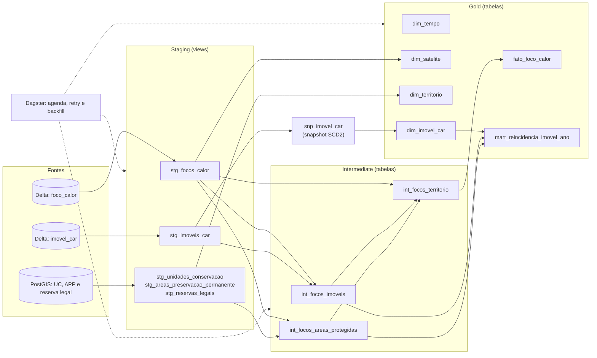

# :material-numeric-3-box: Entrega 3: Modelagem Dimensional, Transformação e Orquestração

> Plataforma Corta-Fogo DF: modelo dimensional em estrela na camada Gold, histórico cadastral com SCD Tipo 2, transformações declarativas no dbt-duckdb, testes de dados e orquestração com Dagster.

## 1. Visão Geral e Pergunta de Gestão

<p class="apresentador"><em>Apresentação: Gabriel Souza</em></p>

Na Entrega 3, os dados que chegaram ao lakehouse na E2 passam a ser modelados, testados e agendados. O modelo responde à pergunta de gestão da E1:

> **Quais imóveis rurais do Distrito Federal tiveram focos de calor reincidentes em áreas de reserva legal, de preservação permanente ou a até 1 km de unidades de conservação entre 2015 e 2025?**

Um imóvel é reincidente quando tem foco em uma dessas áreas em pelo menos 2 anos civis (UTC) distintos. Todos os satélites entram na contagem.



<p style="text-align: center; font-size: 0.9em; color: #64748b;">Figura 1: Linhagem dos modelos dbt, das tabelas abertas da E2 ao mart de reincidência</p>

## 2. Divisão de Responsabilidades da Equipe

<p class="apresentador"><em>Apresentação: Gabriel Souza</em></p>

| Integrante | Frente | Issue | Entrega |
| :--- | :--- | :---: | :--- |
| Gabriel Souza | Coordenação e Pergunta de Gestão | [#17](https://github.com/BeyondMagic/corta-fogo-df/issues/17) | Este relatório, consulta final e auditoria do checklist |
| Manoel Felipe | Modelagem Dimensional Gold | [#18](https://github.com/BeyondMagic/corta-fogo-df/issues/18) | Esquema estrela, `fato_foco_calor` e `mart_reincidencia_imovel_ano` |
| Samuel Ribeiro | Dimensão de Variação Lenta | [#19](https://github.com/BeyondMagic/corta-fogo-df/issues/19) | Snapshot e `dim_imovel_car` (SCD Tipo 2) |
| Gabriel Fernando | Camadas de Transformação | [#20](https://github.com/BeyondMagic/corta-fogo-df/issues/20) | Projeto dbt-duckdb, staging e intermediate |
| Elias F. | Testes de Dados | [#21](https://github.com/BeyondMagic/corta-fogo-df/issues/21) | Testes de esquema, volume, integridade e distribuição |
| Cláudio Henrique | Orquestração | [#22](https://github.com/BeyondMagic/corta-fogo-df/issues/22) | Dagster no Compose, retry e backfill |
| João V. Farias | ADR 0003 e Mapa Interativo | [#23](https://github.com/BeyondMagic/corta-fogo-df/issues/23) | ADR 0003 e mapa com linha do tempo |

## 3. Modelagem Dimensional Gold e Granularidades

<p class="apresentador"><em>Apresentação: Manoel Felipe</em></p>

A camada Gold é uma estrela em torno da detecção de foco. Cada modelo declara a granularidade por extenso ([especificação completa](../../modelagem/esquema_dimensional_gold.md)):

| Modelo | Granularidade | Linhas |
| :--- | :--- | ---: |
| `fato_foco_calor` | Uma linha por detecção de foco no tempo e no espaço por sensor orbital (`id_foco`). | 38.944 |
| `dim_tempo` | Uma linha por data civil de 01/01/2015 a 31/12/2025, com `is_estacao_seca` (maio a setembro). | 4.018 |
| `dim_satelite` | Uma linha por satélite detector, com `is_referencia` para o `AQUA_M-T`. | 20 |
| `dim_territorio` | Uma linha por feição de UC, APP ou reserva legal, com amortecimento de 1 km nas UCs. | 15.814 |
| `dim_imovel_car` | Uma linha por versão cadastral do imóvel (SCD Tipo 2). | 21.047 |
| `mart_reincidencia_imovel_ano` | Uma linha por imóvel por ano civil UTC com foco em reserva legal, APP ou a até 1 km de UC. | 8.271 |

Três pontos explicam contagens que parecem divergir entre o PostGIS e a Gold:

- **Focos:** o PostGIS tem 38.945. O lote da E2 descarta uma detecção com `id_foco` repetido (mesmas coordenadas, horário e satélite), então a fato tem 38.944.
- **Feições territoriais:** a dimensão tem 84 UCs, 2.234 APPs e 13.496 reservas legais. O PostGIS tem 13.499 reservas legais: 3 polígonos idênticos no mesmo imóvel entram uma vez.
- **Foco e imóvel:** a relação é N:N, porque o SICAR tem imóveis sobrepostos. `int_focos_imoveis` tem 76.115 pares para 38.944 focos. Por isso o imóvel entra no mart e não na fato.

## 4. Dimensão de Variação Lenta (SCD Tipo 2) para Imóveis Rurais

<p class="apresentador"><em>Apresentação: Samuel Ribeiro</em></p>

Imóveis rurais são retificados, mudam de área e de situação cadastral. Sobrescrever essas mudanças tornaria errada a resposta sobre focos de anos anteriores. A `dim_imovel_car` guarda uma linha por versão:

| Elemento | Regra |
| :--- | :--- |
| Detecção da mudança | Snapshot `snp_imovel_car`, estratégia `timestamp` sobre `data_hora_ingestao`. |
| Chave | `sk_imovel = md5(cod_imovel, lsn_origem)`, uma por versão. Reentregas do CDC com o mesmo `lsn_origem` não geram versão nova. |
| Vigência | `dbt_valid_from <= data_hora_evento < dbt_valid_to`. A primeira versão vale desde 1900-01-01 e a versão corrente vai até 9999-12-31 (`is_current`). |
| Cruzamento com focos | O mart associa cada foco à versão do imóvel vigente na data do evento. |

Evidências: o teste unitário `dim_imovel_car_preserva_versao_anterior_para_focos_antigos` e os testes singulares de versão corrente única e de vigências contíguas passam no `dbt build`. A demonstração `orquestracao/demo_scd2_imovel.py` retifica e cancela um imóvel em uma cópia descartável do Delta e gera 3 versões (original, retificada e cancelada). Cada foco casa com a versão vigente na data do evento: um foco de 2020 usa a área original e um foco posterior à retificação usa a área nova.

A tabela tem hoje 21.047 versões, uma por imóvel, porque só a carga inicial do CDC foi observada. O histórico tem a granularidade da frequência do `dbt build`: várias mudanças entre duas execuções viram uma versão.

## 5. Transformações Declarativas no dbt-duckdb

<p class="apresentador"><em>Apresentação: Gabriel Fernando</em></p>

O dbt-duckdb lê as tabelas Delta com `delta_scan` e anexa o PostGIS em modo somente leitura. Nada roda no banco operacional.

| Camada | Modelos | Materialização | Linhas |
| :--- | :--- | :--- | ---: |
| Staging | 5 modelos `stg_*` (focos, imóveis, UCs, APPs, reservas legais) | view | - |
| Intermediate | `int_focos_imoveis` (pares foco e imóvel) | tabela | 76.115 |
| Intermediate | `int_focos_areas_protegidas` (foco em reserva legal, APP ou 1 km de UC) | tabela | 32.778 |
| Intermediate | `int_focos_territorio` (uma linha por foco, com as flags territoriais) | tabela | 38.944 |
| Snapshot | `snp_imovel_car` | snapshot | 21.047 |
| Gold | 5 modelos dimensionais e o mart de reincidência | tabela | ver seção 3 |

O `dbt run` materializa as 9 tabelas e as 5 views em 9,9 s. Os cruzamentos usam `ST_Intersects` (reserva legal e APP) e `ST_DWithin` a 1.000 m (UCs). Para reproduzir:

```bash
docker compose --profile transformacao run --rm dbt build
```

## 6. Testes de Dados e Detecção de Erros Silenciosos

<p class="apresentador"><em>Apresentação: Elias F.</em></p>

O `dbt build` executa 173 testes de dados e 1 teste unitário:

| Tipo | Qtd | O que garante |
| :--- | ---: | :--- |
| `not_null` e `unique` | 126 e 13 | Chaves e atributos obrigatórios. |
| `unique_combination_of_columns` | 4 | Granularidade das tabelas de chave composta. |
| `accepted_values` | 16 | Domínios, como `tipo_area` e situação cadastral. |
| `relationships` | 8 | Fato para `dim_tempo` e `dim_satelite`; `int_focos_areas_protegidas` para `dim_territorio`; `int_focos_imoveis` e o mart para `dim_imovel_car`. |
| Singulares em SQL | 6 | Volume anual, distribuição sazonal, distribuição espacial, SCD2 (2) e granularidade do mart. |

Os três testes que detectam erro silencioso, com o valor medido na série real:

| Teste | Regra | Valor medido |
| :--- | :--- | :--- |
| Volume anual | Cada ano de 2015 a 2025 tem pelo menos 500 focos e 80 do `AQUA_M-T`. | Menor ano: 2018, com 948 focos e 88 do `AQUA_M-T`. |
| Distribuição sazonal | Pelo menos 70% dos focos em maio a setembro, no total e em cada ano. | 84,4% no total; pior ano: 2020, com 70,1%. |
| Distribuição espacial | 100% dos focos, imóveis e feições dentro do envelope do DF e com geometria válida. | Sem violações. |

Resultado do `dbt build`: 189 de 189 nós aprovados (1 snapshot, 14 modelos, 173 testes de dados e 1 teste unitário), sem falhas.

## 7. Orquestração com Dagster: Retry e Backfill

<p class="apresentador"><em>Apresentação: Cláudio Henrique</em></p>

O Dagster lê o manifesto do dbt e monta o grafo de ativos (*software-defined assets*). Sobe sob o perfil `orquestracao` do Compose, sem JVM:

```bash
docker compose --profile orquestracao up -d --build
```

| Elemento | Configuração |
| :--- | :--- |
| `job_transformacao` | `dbt build` de todos os modelos, agendado todo dia às 03:00 (America/Sao_Paulo). |
| `job_lote_mensal` | Uma partição mensal de `foco_calor_delta` (132 partições, jan/2015 a dez/2025), sob demanda. |
| Retry | `RetryPolicy` com até 3 reexecuções e recuo exponencial a partir de 2 s. Falha induzida com `FALHAS_INDUZIDAS=N`. |
| Execuções | Uma por vez (`max_concurrent_runs: 1`), porque o DuckDB aceita um escritor por arquivo. |

Retry e backfill foram executados em 10/11/2026:

| Teste | Execução | Resultado |
| :--- | :--- | :--- |
| Transformação orquestrada | `job_transformacao` | `dbt build` completo pelo Dagster: 189 de 189 nós aprovados, com os testes como verificações de ativo (*asset checks*). |
| Retry com falha induzida | `FALHAS_INDUZIDAS=3` e backfill de `2024-08` | 4 tentativas, com sucesso na quarta. Intervalos de 4,7 s, 8,7 s e 17,1 s entre as reexecuções. |
| Backfill das partições 2024-08 a 2024-10 com o Delta íntegro | `orquestracao/demo_backfill.py` | 3 execuções com sucesso. Total inalterado em 38.944 linhas, sem duplicata. |
| Perda da partição 2024-09 | idem | 3.079 linhas removidas. A tabela cai para 35.865 linhas. |
| Backfill só de 2024-09 | idem | 38.944 linhas restauradas, todas com `id_foco` único. As outras 131 partições ficam idênticas às do início. |

O reprocessamento é idempotente porque o `MERGE` de `batch_ingest.py` só insere `id_foco` ausente.

## 8. Decisão Técnica de Arquitetura

<p class="apresentador"><em>Apresentação: João V. Farias</em></p>

Síntese da decisão sobre a modelagem analítica e a ferramenta de transformação:

- **Contexto:** com os dados no Delta Lake, faltava organizar a camada de consumo e escolher a ferramenta que a transforma, testa e agenda sem carregar o banco operacional.
- **Alternativas:** estrela com fato atômica e mart agregado, tabela única desnormalizada (OBT) e Data Vault; dbt-duckdb com Dagster, scripts SQL no cron (opção nula) e SQLMesh com Airflow.
- **Medição:** a pergunta de gestão leva 41,8 s por junção espacial direta no PostGIS (E1). No modelo dimensional, o `dbt run` calcula o mart em 9,9 s e a consulta final lê o resultado em 5,0 ms (seção 9). Replicar polígonos de até 54 mil vértices em uma OBT multiplicaria o volume físico.
- **Decisão:** estrela com fato atômica e mart agregado, transformada por dbt-duckdb e orquestrada por Dagster, com SCD Tipo 2 em `dim_imovel_car`.
- **Consequências:** consultas analíticas isoladas do OLTP, linhagem declarada e histórico cadastral preservado. A contrapartida é sincronizar os volumes `lakehouse` e `warehouse` entre os serviços e aceitar que o histórico tenha a granularidade do `dbt build`.
- **Gatilhos de revisão:** volume acima de 50 GB ou processamento distribuído, mais de dez domínios independentes (Data Mesh) ou stream do INPE com latência inferior a 10 s.

## 9. Consulta Analítica Final

<p class="apresentador"><em>Apresentação: João V. Farias</em></p>

A consulta lê o mart `mart_reincidencia_imovel_ano` e devolve uma linha por imóvel reincidente. Fica versionada em [`consulta_pergunta_gestao.sql`](https://github.com/BeyondMagic/corta-fogo-df/blob/main/transformacao/analyses/consulta_pergunta_gestao.sql):

```sql
select
    cod_imovel,
    arg_max(situacao, ano)          as situacao,
    arg_max(area_ha, ano)           as area_ha,
    anos_com_foco_protegido         as anos_com_foco,
    lista_anos_protegidos           as lista_anos,
    sum(total_focos)::integer       as total_focos,
    bool_or(atinge_reserva_legal)   as atinge_reserva_legal,
    bool_or(atinge_app)             as atinge_app,
    bool_or(atinge_uc_1km)          as atinge_uc_1km
from {{ ref('mart_reincidencia_imovel_ano') }}
where imovel_reincidente
group by cod_imovel, anos_com_foco_protegido, lista_anos_protegidos
order by total_focos desc, cod_imovel
```

```bash
docker compose --profile transformacao run --rm dbt show --select consulta_pergunta_gestao --limit 20
docker compose --profile transformacao run --rm dbt show --select resumo_pergunta_gestao --limit 40
```

A consulta lê o mart pronto e responde em 5,0 ms (mediana de 20 execuções no DuckDB). O resultado coincide com o da `gold.mv_imoveis_reincidentes_areas_protegidas` do PostGIS (E1): 1.593 imóveis, com os mesmos focos, anos e flags em cada um (37.693 focos no total). A diferença é que o mart associa cada foco à versão cadastral do imóvel vigente na data do evento.

## 10. Resultados da Pergunta de Gestão

<p class="apresentador"><em>Apresentação: Gabriel Fernando</em></p>

Números do [`resumo_pergunta_gestao.sql`](https://github.com/BeyondMagic/corta-fogo-df/blob/main/transformacao/analyses/resumo_pergunta_gestao.sql), sobre os 21.047 imóveis do cadastro:

| Métrica | Imóveis |
| :--- | ---: |
| Com foco em área protegida em algum ano | 4.068 |
| **Reincidentes (foco em 2 anos ou mais)** | **1.593** |
| Reincidentes com foco em reserva legal | 958 |
| Reincidentes com foco em APP | 382 |
| Reincidentes com foco a até 1 km de UC | 1.231 |

Os critérios se sobrepõem: um imóvel pode atingir mais de um. Os 1.593 imóveis somam 37.693 focos, e um foco sobre imóveis sobrepostos conta em cada um deles.

| Anos com foco | 2 | 3 | 4 | 5 | 6 | 7 | 8 | 9 | 10 | 11 |
| :--- | ---: | ---: | ---: | ---: | ---: | ---: | ---: | ---: | ---: | ---: |
| Imóveis | 717 | 331 | 159 | 120 | 74 | 47 | 50 | 31 | 23 | 41 |

A pergunta não filtra a situação cadastral. Dos 1.593, 1.413 estão ativos (AT), 107 pendentes (PE), 41 suspensos (SU) e 32 cancelados (CA).

## 11. Imóveis com Mais Focos Reincidentes

<p class="apresentador"><em>Apresentação: Samuel Ribeiro</em></p>

Os 10 imóveis com mais focos entre 2015 e 2025:

| Código CAR | Situação | Área (ha) | Anos | Focos | RL | APP | UC |
| :--- | :---: | ---: | ---: | ---: | :---: | :---: | :---: |
| `DF-5300108-AB840D7B499B43E69C3D999165FF2475` | CA | 94.379 | 11 | 3.597 | não | sim | sim |
| `DF-5300108-1274A9532343473DB7413440C0ABF8AD` | CA | 103.415 | 11 | 3.077 | não | sim | sim |
| `DF-5300108-B46B13EE13B14D348E3124DD0F77D8B1` | SU | 63.232 | 11 | 2.623 | não | sim | sim |
| `DF-5300108-0AA80F34AD524112AF32834A78277A32` | PE | 16.398 | 11 | 1.370 | não | sim | sim |
| `DF-5300108-BB7A677A0ACB4496B63D413536F8DE0E` | CA | 38.793 | 11 | 1.332 | não | sim | sim |
| `DF-5300108-981FD2BCDD10433693BFCD3A6D69DD2E` | PE | 8.441 | 11 | 1.010 | não | sim | sim |
| `DF-5300108-1A34898F66584106B176A816F4FDCD5E` | PE | 11.583 | 11 | 755 | não | sim | sim |
| `DF-5300108-DCFF71953F5F40FF84B8A1D477E3E733` | SU | 35.219 | 11 | 545 | não | sim | sim |
| `DF-5300108-6B90D19CDB024E799BD7D49DA7B4AFE8` | AT | 2.894 | 4 | 502 | não | sim | sim |
| `DF-5300108-CCB5F18038C349AE9EEA9AD26EE5E5A6` | PE | 5.718 | 11 | 470 | sim | sim | sim |

Só 1 dos 10 está com cadastro ativo, e 7 passam de 10.000 ha. Entre todos os reincidentes a mediana é de 50,9 ha e apenas 9 passam de 10.000 ha. Para vistorias, vale cruzar este ranking com a situação cadastral antes de priorizar.

## 13. Auditoria do Checklist da E3

<p class="apresentador"><em>Apresentação: Manoel Felipe</em></p>

Os oito itens da [página da E3](https://unb-bd2.github.io/PlanoEnsino/projeto/e3/), conferidos contra o repositório e contra uma execução completa do pipeline em 10/11/2026:

| # | Requisito | Status | Evidência |
| :---: | :--- | :---: | :--- |
| 1 | Fato e dimensões com granularidade declarada e ao menos uma dimensão de variação lenta | Atendido | Seções 3 e 4; `dim_imovel_car` em SCD Tipo 2. |
| 2 | Transformações versionadas em dbt, organizadas em camadas | Atendido | Seção 5; `transformacao/` com staging, intermediate, snapshot e gold. |
| 3 | Testes de esquema, volume, unicidade, integridade referencial e distribuição | Atendido | Seção 6; 189 de 189 nós aprovados no `dbt build`. |
| 4 | Orquestração agendada, com grafo, retry e backfill demonstrado | Atendido | Seção 7; Dagster com agenda diária, `RetryPolicy` e backfill por partição executado. |
| 5 | Consulta otimizada com `EXPLAIN (ANALYZE, BUFFERS)` antes e depois | Parcial | Só na E1: `scripts/benchmark/benchmark_pergunta_gestao.sql` e ADR 0001, com e sem índice GiST. Falta o plano antes e depois na camada analítica. |
| 6 | Freshness e SLA declarado para ao menos uma tabela de consumo | Pendente | Não há métrica de freshness nem SLA no repositório. |
| 7 | ADR sobre modelagem analítica ou ferramenta de transformação | Atendido | Seção 8; ADR 0003, aceito em 09/11/2026. |
| 8 | Painel que responda à pergunta de gestão | Parcial | O mapa usa focos reais, mas as camadas de UC e de imóveis são amostra ilustrativa (seção 12). A resposta calculada pelo modelo está nas seções 9 a 11. |

## 14. Artefatos e Entregáveis

<p class="apresentador"><em>Apresentação: Gabriel Souza</em></p>

Código, testes e documentos da Entrega 3, versionados no repositório:

- **[Decisão de Arquitetura 0003](../../adr/03-modelagem-dimensional-e-ferramenta-de-transformacao.md):** modelagem dimensional e ferramenta de transformação, com alternativas e medições.
- **[Esquema dimensional Gold](../../modelagem/esquema_dimensional_gold.md):** granularidades e decisões de modelagem.
- **[Projeto dbt (`transformacao/`)](https://github.com/BeyondMagic/corta-fogo-df/tree/main/transformacao):** staging, intermediate, snapshot, gold, testes e consultas em `analyses/`.
- **[Consulta final](https://github.com/BeyondMagic/corta-fogo-df/blob/main/transformacao/analyses/consulta_pergunta_gestao.sql) e [resumo da pergunta de gestão](https://github.com/BeyondMagic/corta-fogo-df/blob/main/transformacao/analyses/resumo_pergunta_gestao.sql):** consultas que geram os números das seções 9 a 11.
- **[Orquestração (`orquestracao/`)](https://github.com/BeyondMagic/corta-fogo-df/tree/main/orquestracao):** ativos, agenda, retry e demonstrações de backfill e de SCD Tipo 2.
- **[Mapa interativo](https://github.com/BeyondMagic/corta-fogo-df/blob/main/docs/javascripts/mapa_corta_fogo.js):** componente Leaflet e [gerador dos dados](https://github.com/BeyondMagic/corta-fogo-df/blob/main/scripts/gerar_dados_mapa.py).
- **[Docker Compose](https://github.com/BeyondMagic/corta-fogo-df/blob/main/docker-compose.yml):** perfis `transformacao` e `orquestracao`.
