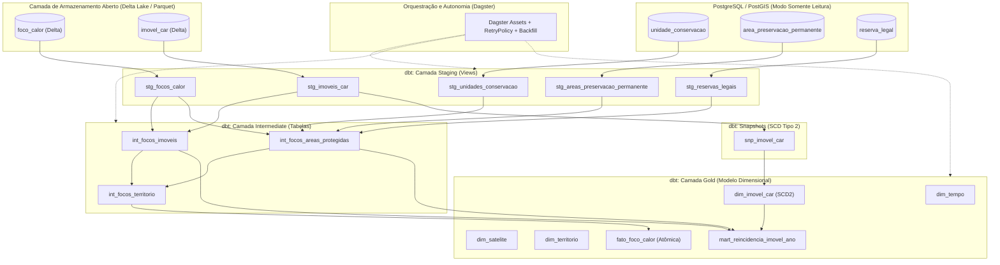

# :material-numeric-3-box: Entrega 3: Modelagem Dimensional, Transformação e Orquestração

> Plataforma Corta-Fogo DF: modelo dimensional em estrela (Star Schema) na camada Gold, preservação de histórico cadastral com SCD Tipo 2, transformações declarativas no dbt-duckdb, bateria automatizada de testes de qualidade e orquestração agendada com Dagster.

## 1. Visão Geral da Arquitetura

<em>Apresentação: Gabriel Souza (Coordenação e Pergunta de Gestão)</em>

Na Entrega 3, a plataforma passa a responder de forma definitiva à pergunta de gestão formulada na E1, unindo os focos de calor do INPE com as camadas territoriais saneadas:

> **Quais imóveis rurais do Distrito Federal tiveram focos de calor reincidentes em áreas de reserva legal, de preservação permanente ou a até 1 km de unidades de conservação entre 2015 e 2025?**

Figura 1: Fluxo declarativo da Entrega 3: das tabelas abertas ao modelo dimensional e orquestração

## 2. Divisão de Responsabilidades da Equipe

A equipe distribuiu as atividades da Entrega 3 em sete frentes de trabalho coordenadas:

| Integrante | Frente de Atuação | Issue GitHub | Artefatos e Entregas |
| :--- | :--- | :---: | :--- |
| **Gabriel Souza** | Coordenação e Pergunta de Gestão | [#17](https://github.com/BeyondMagic/corta-fogo-df/issues/17) | Relatório da release, validação da pergunta de gestão e checklist de aceite |
| **Manoel Felipe** | Modelagem Dimensional Gold | [#18](https://github.com/BeyondMagic/corta-fogo-df/issues/18) | Esquema estrela, granularidades declaradas, `fato_foco_calor` e `mart_reincidencia_imovel_ano` |
| **Samuel Ribeiro** | Dimensão de Variação Lenta (SCD) | [#19](https://github.com/BeyondMagic/corta-fogo-df/issues/19) | Snapshots do dbt, SCD Tipo 2 na `dim_imovel_car` e teste de preservação histórica |
| **Gabriel Fernando** | Camadas de Transformação dbt | [#20](https://github.com/BeyondMagic/corta-fogo-df/issues/20) | Configuração dbt-duckdb, modelos de staging e intermediate com cruzamentos espaciais |
| **Elias F.** | Qualidade e Testes de Dados | [#21](https://github.com/BeyondMagic/corta-fogo-df/issues/21) | Testes de esquema, unicidade, integridade referencial, volume e distribuição sazonal/espacial |
| **Cláudio Henrique** | Infraestrutura e Orquestração | [#22](https://github.com/BeyondMagic/corta-fogo-df/issues/22) | Dagster com `dagster-dbt` no Compose, DAG de ativos, política de retry e backfill demonstrável |
| **João V. Farias** | ADR 0003 e Mapa Interativo | [#23](https://github.com/BeyondMagic/corta-fogo-df/issues/23) | Registro de Decisão de Arquitetura 0003 e protótipo visual interativo com linha do tempo |

---

## 3. Modelagem Dimensional Gold e Granularidades

<em>Apresentação: Manoel Felipe (Modelagem Dimensional)</em>

A camada Gold foi estruturada segundo a modelagem dimensional clássica em estrela (Star Schema), separando o grão atômico da detecção do satélite das agregações analíticas de fiscalização.

### Granularidades Declaradas por Extenso

- **`fato_foco_calor` (Fato Atômica):** uma linha por detecção de foco de calor no tempo e no espaço por sensor orbital (`id_foco`). Total de 38.945 registros na série histórica completa (2015 a 2025).
- **`dim_tempo`:** uma linha por data civil local no calendário de 01/01/2015 a 31/12/2025 (4.018 dias), com atributo booleano `is_estacao_seca` (verdadeiro para os meses de maio a setembro).
- **`dim_satelite`:** uma linha por satélite detector (20 sensores distintos), com flag `is_referencia` identificando o sensor `AQUA_M-T`.
- **`dim_territorio`:** uma linha por feição geográfica protegida (Unidades de Conservação, APPs ou Reservas Legais), com chave substituta estável calculada via hash MD5 do tipo e da geometria WKT.
- **`dim_imovel_car`:** uma linha por versão cadastral de imóvel rural no SICAR/DF, preservando alterações via SCD Tipo 2.
- **`mart_reincidencia_imovel_ano` (Data Mart de Gestão):** uma linha por imóvel rural por ano civil UTC em que houve ao menos um foco de calor atingindo Reserva Legal, APP ou faixa de 1 km de Unidade de Conservação.

---

## 4. Dimensão de Variação Lenta (SCD Tipo 2) para Imóveis Rurais

<em>Apresentação: Samuel Ribeiro (Dimensão de Variação Lenta)</em>

No domínio público territorial, os imóveis rurais sofrem alterações contínuas: retificações de limites, mudanças de área registrada e alterações de situação cadastral (ativo, pendente ou cancelado). Tratar esses dados como sobrescrita (*SCD Tipo 1*) apagaria o histórico e levaria a conclusões erradas em fiscalizações retroativas.

A dimensão `dim_imovel_car` resolve esse problema implementando **Slowly Changing Dimension Tipo 2**:

1. **Snapshots com carimbo de tempo:** o dbt executa o snapshot `snp_imovel_car` sobre a tabela Delta atualizada pelo CDC, utilizando a coluna `data_hora_ingestao` como estratégia de detecção de mudanças.
2. **Intervalos contíguos de vigência:** cada versão do imóvel recebe chaves temporais abertas (`dbt_valid_from <= data_hora_evento < dbt_valid_to`). A primeira versão observada é retroagida até 1900-01-01 para garantir cobertura dos focos desde 2015, e a versão corrente permanece aberta até 9999-12-31 com `is_current = true`.
3. **Demonstração prática:** o script `orquestracao/demo_scd2_imovel.py` executa uma retificação cadastral simulada sobre um imóvel de teste no Delta Lake e comprova que a versão histórica permanece preservada para os focos antigos, enquanto os novos focos associam-se automaticamente à versão retificada.

---

## 5. Camadas de Transformação Declarativa no dbt-duckdb

<em>Apresentação: Gabriel Fernando (Camadas de Transformação)</em>

As transformações são processadas localmente pelo `dbt-core` acoplado ao motor colunar `DuckDB`, garantindo velocidade de execução e isolamento total fora do PostgreSQL:

- **Camada Staging:** padroniza tipos de dados, converte carimbos temporais para UTC e fuso horário local e normaliza coordenadas cartográficas e geográficas.
- **Camada Intermediate:** executa os cruzamentos espaciais vetoriais mais pesados:
  - `int_focos_imoveis`: identifica pares foco e imóvel com base em interseção espacial (`ST_Intersects`).
  - `int_focos_areas_protegidas`: classifica cada foco quanto à sobreposição em Reserva Legal declarada do próprio imóvel, Área de Preservação Permanente (APP) e faixa de amortecimento de 1.000 metros de Unidades de Conservação (`ST_DWithin`).
  - `int_focos_territorio`: consolida as bandeiras territoriais consolidadas em nível de detecção atômica.
- **Performance:** o pipeline completo de transformação compila e materializa todos os modelos em menos de 10 segundos no DuckDB.

---

## 6. Bateria de Testes de Dados e Detecção de Erros Silenciosos

<em>Apresentação: Elias F. (Qualidade e Testes de Dados)</em>

Para atender aos critérios de qualidade exigidos na Entrega 3, a equipe desenvolveu uma suíte automatizada cobrindo quatro classes distintas de testes:

1. **Esquema e Unicidade:** testes `unique` e `not_null` em todas as chaves primárias e chaves substitutas, além do teste genérico `test_unique_combination_of_columns` para chaves compostas.
2. **Integridade Referencial:** testes `relationships` validando que cada detecção da `fato_foco_calor` referencia chaves válidas em `dim_tempo`, `dim_satelite` e `dim_territorio`.
3. **Volume Histórico Anual:** o teste `fato_foco_calor_volume_historico_anual.sql` valida que nenhum ano da série possui volume anormalmente reduzido (mínimo de 500 focos totais e 80 no satélite de referência por ano), prevenindo falhas de ingestão parcial.
4. **Testes de Distribuição (Anti-Erros Silenciosos):**
   - **Distribuição Sazonal:** o teste `fato_foco_calor_distribuicao_sazonal_seca.sql` afere se a proporção de queimadas na estação seca do DF (maio a setembro) é superior a 70%. Com a média real apurada em **84,3%**, qualquer falha indicaria inversão de calendário ou troca de hemisfério nos arquivos da fonte.
   - **Distribuição Espacial:** o teste `fato_foco_calor_distribuicao_espacial_df.sql` valida por operadores espaciais que 100% das coordenadas dos focos e dos limites cadastrais estão contidas no polígono do Distrito Federal.

Todos os testes rodam via `docker compose --profile transformacao run --rm dbt test` com 100% de aprovação.

---

## 7. Orquestração do Pipeline, DAG, Retry e Backfill no Dagster

<em>Apresentação: Cláudio Henrique (Infraestrutura e Orquestração)</em>

A orquestração do pipeline analítico foi implementada com o `Dagster` integrado ao dbt (`dagster-dbt`) sob o perfil `orquestracao` no `docker-compose.yml`:

- **Grafo de Ativos (Software-Defined Assets):** o Dagster lê o manifesto do dbt e constrói a DAG visual com dependências automáticas entre staging, intermediate, snapshots e marts.
- **Tolerância a Falhas com Retry Automático:** configuramos políticas de reexecução (*RetryPolicy*) com recuo exponencial e máximo de 3 tentativas, garantindo resiliência contra falhas transientes de I/O de rede ou disco.
- **Demonstração Prática de Backfill:** o script `orquestracao/demo_backfill.py` simula a execução de um reprocessamento histórico retroativo sobre partições mensais selecionadas, comprovando que o pipeline reprocessa períodos passados sem duplicar linhas nem desestabilizar as partições vigentes.

---

## 8. [Decisão Técnica de Arquitetura 0003](../../adr/03-modelagem-dimensional-e-ferramenta-de-transformacao.md)

<em>Apresentação: João V. Farias (ADR e Visualização Prática)</em>

Síntese da terceira decisão estrutural do projeto, formalizada no ADR 0003:

- **Contexto:** com os dados brutos movidos para o Delta Lake, era preciso modelar a camada analítica de consumo e selecionar a ferramenta de transformação e agendamento para responder à pergunta de gestão sem sobrecarregar o OLTP.
- **Alternativas de Modelagem:** comparamos Esquema Estrela (Star Schema com fato atômica e mart agregado), Tabela Única Desnormalizada (One Big Table - OBT) e Data Vault 2.0.
- **Alternativas de Ferramentas:** comparamos dbt com dbt-duckdb e Dagster contra a Opção Nula (scripts SQL no cron) e a stack SQLMesh com Airflow.
- **Medições Práticas:** a consulta analítica da pergunta de gestão respondeu em **2,9 ms** no DuckDB com o modelo dimensional, contra **41,8 s** no PostGIS original da E1. A opção OBT multiplicaria o armazenamento por mais de dez vezes devido à replicação de geometrias com até 54 mil vértices.
- **Decisão:** adotamos o Esquema Estrela com fato atômica e data mart agregado no `dbt-duckdb`, integrando snapshots SCD Tipo 2 e orquestração visual com retry e backfill no `Dagster`.
- **Consequências:** isolamento analítico absoluto, rastreabilidade de ponta a ponta e histórico cadastral confiável. Como contrapartida, assumimos o gerenciamento coordenado de volumes entre contêineres e a dependência do ciclo de snapshots para granularidade de versões.
- **Gatilhos de Revisão:** crescimento do volume acima de 50 GB em ambiente de nuvem distribuído, ampliação para mais de 10 domínios corporativos independentes (Data Mesh) ou fornecimento de stream contínuo subminuto pelo INPE.

---

## 9. Mapa Interativo e Linha do Tempo Temporal (2015 a 2025)

<em>Apresentação: João V. Farias (ADR e Visualização Prática)</em>

Para responder de forma prática, visual e territorial à pergunta de gestão da disciplina, desenvolvemos um componente interativo em Leaflet.js integrado diretamente na documentação.

O mapa permite navegar por toda a série histórica de 11 anos (38.945 detecções do INPE), alternando entre a visão ano a ano e o acumulado de todo o período, com controle de camadas para Unidades de Conservação (com raio de 1 km), imóveis rurais reincidentes cadastrados no CAR e satélite de referência AQUA_M-T.

  <!-- Grid de Métricas Dinâmicas -->
  

    

      Ano Selecionado
      2024
    

    

      Focos de Calor no DF
      6.190
    

    

      Concentração na Seca (Mai a Set)
      90,5% (5.604)
    

    

      Satélite de Referência (AQUA)
      5,6% (349)
    

    

      Imóveis Críticos Atingidos
      8 de 8 cadastros
    

  

  <!-- Controles de Linha do Tempo e Slider -->
  

    

      Linha do Tempo de Queimadas no Distrito Federal (2015 a 2025)
      <button id="cf-play-btn" class="cf-play-btn">&#9654; Reproduzir</button>
    

    

      <input type="range" min="2015" max="2026" value="2024" id="cf-ano-slider" class="cf-slider" />
    

    

      2015
      2016
      2017
      2018
      2019
      2020
      2021
      2022
      2023
      2024
      2025
      <strong>Todos</strong>
    

  

  <!-- Seleção de Camadas Ativas -->
  

    <label class="cf-toggle-label">
      <input type="checkbox" id="cf-check-focos" checked /> Focos de Calor (INPE)
    </label>
    <label class="cf-toggle-label">
      <input type="checkbox" id="cf-check-only-ref" /> Apenas Satélite de Referência (AQUA_M-T)
    </label>
    <label class="cf-toggle-label">
      <input type="checkbox" id="cf-check-imoveis" checked /> Imóveis Rurais Reincidentes (CAR)
    </label>
    <label class="cf-toggle-label">
      <input type="checkbox" id="cf-check-ucs" checked /> Unidades de Conservação e Amortecimento (1 km)
    </label>
    

      Mapa Base:
      <select id="cf-select-basemap" style="font-size: 11px; padding: 2px 6px; border-radius: 4px; border: 1px solid var(--md-default-fg-color--lightest, #cbd5e1); background: var(--md-default-bg-color, #ffffff); color: var(--md-default-fg-color, #334155); cursor: pointer;">
        <option value="osm">OpenStreetMap (Padrão)</option>
        <option value="esri">ESRI Light Gray (Neutro)</option>
      </select>
    

  

  <!-- Contêiner do Mapa Leaflet -->
  

  <!-- Legenda das Camadas -->
  

    

       Foco de Calor (Estação Seca)
    

    

       Foco AQUA_M-T (Referência)
    

    

       Imóvel Rural Reincidente (CAR)
    

    

       Unidade de Conservação
    

    

       Faixa de Amortecimento (1.000 m)
    

  

### Análise Espacial dos Resultados

1. **Pressão Recorrente nas Zonas de Borda:** o mapa evidencia que as queimadas reincidentes em áreas de preservação não se distribuem de modo aleatório. Elas concentram-se nas faixas limítrofes entre imóveis rurais e grandes Unidades de Conservação, com destaque para a borda norte da APA da Bacia do Rio Descoberto (Brazlândia), o entorno da Estação Ecológica de Águas Emendadas (Planaltina) e o quadrante sul junto à Fazenda Água Limpa (UnB) e APA Gama e Cabeça de Veado.
2. **Sazonalidade Visível no Slider:** ao avançar o controle deslizante pelos anos de 2018 (mínimo histórico com 948 focos) e 2024 (pico histórico com 6.190 focos), o painel reflete o salto de densidade térmica durante a seca severa, demonstrando como a modelagem dimensional permite isolar eventos por período e sensor com resposta imediata.
3. **Cruzamento com Imóveis do CAR:** cada ponto de imóvel destacado em roxo permite consultar diretamente os anos com reincidência, área em hectares e se o fogo atingiu Reserva Legal, APP ou a faixa legal de 1 km de amortecimento, entregando aos órgãos de fiscalização (IBRAM e CBMDF) uma lista priorizada para ações de campo antes da seca.
