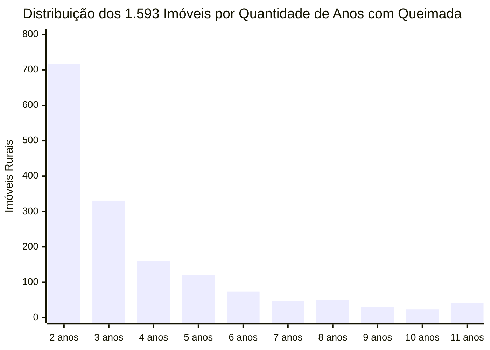

*Histograma de recorrência temporal. Embora a maioria dos reincidentes apresente focos em 2 a 3 anos distintos (1.048 imóveis), 41 propriedades no DF tiveram ocorrências de calor registradas em todos os 11 anos completos analisados (2015 a 2025).*
