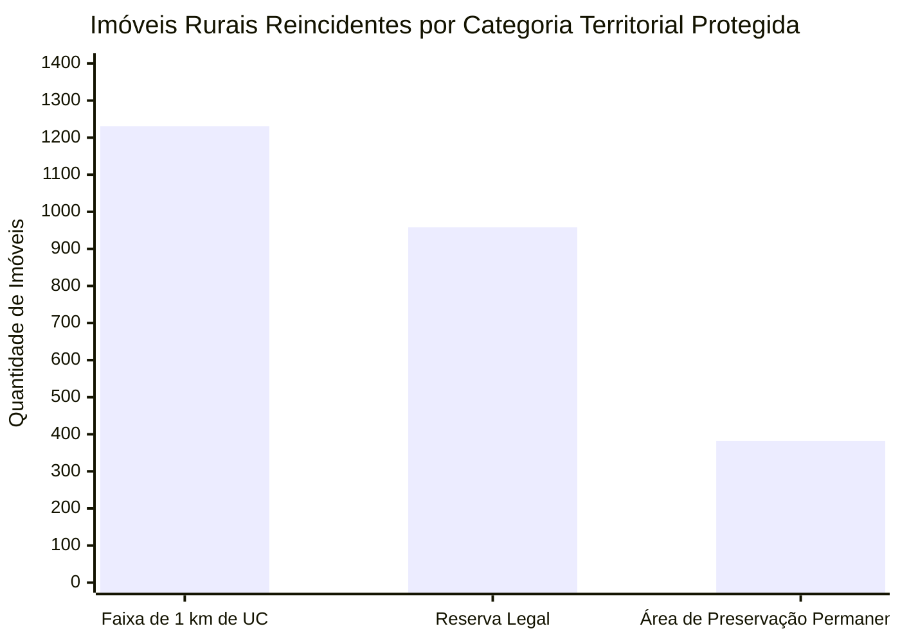

*Total de imóveis reincidentes com detecções em cada categoria protegida. As categorias se sobrepõem: um mesmo imóvel pode ter focos em Reserva Legal e simultaneamente estar situado a menos de 1 km do limite de uma Unidade de Conservação.*
