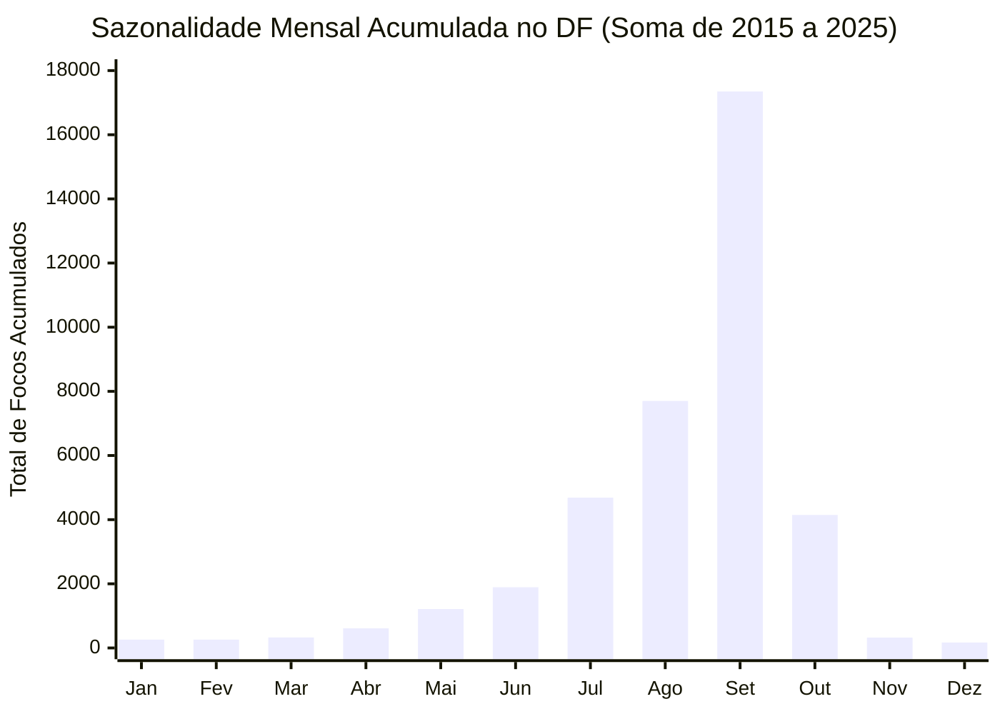

*Distribuição mensal consolidada. O mês de setembro sozinho concentra 17.348 ocorrências (44,5% do acumulado de 11 anos), evidenciando o momento mais severo de estiagem e risco de incêndios florestais no Cerrado.*
