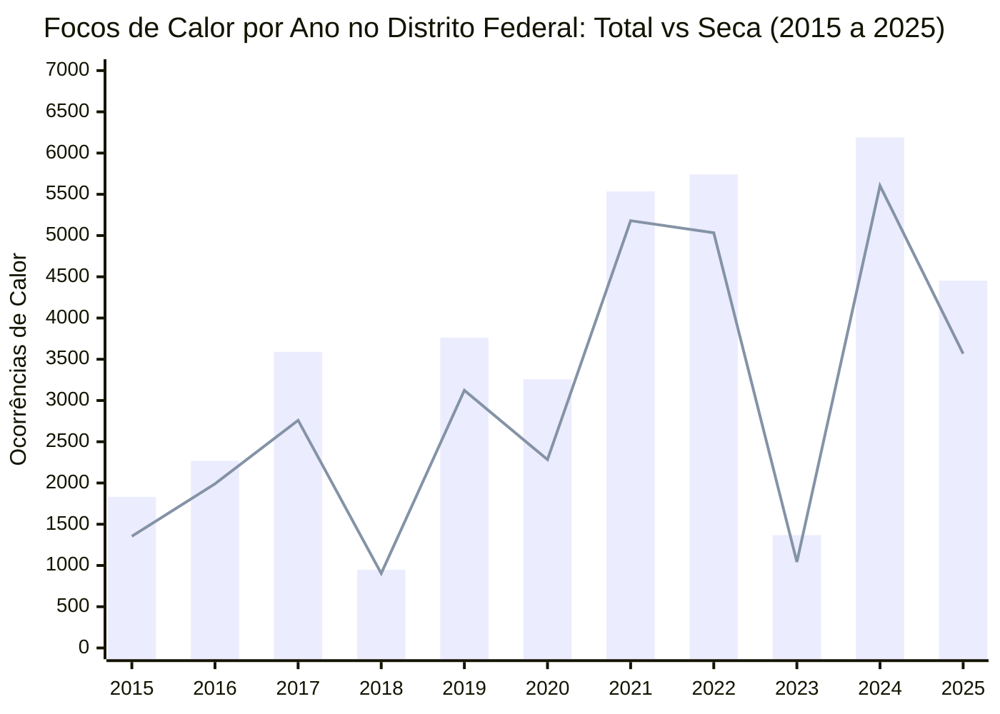

*Barras indicam o volume total de focos por ano (todos os sensores); a linha contínua indica os focos restritos aos meses de seca (maio a setembro). Em 2024, a estiagem prolongada provocou o ápice de 6.190 detecções no DF.*
